# sdrexplorer architecture

How sdrexplorer is built: the repositories, the processes, the receive and transmit flowgraphs, the
threads, the module system, and where data lives. It is meant for contributors to the core and for module
authors who want to know what happens behind the [module API](module-api.md).

Diagrams are [Mermaid](https://mermaid.js.org/); GitHub, GitLab and most Markdown viewers draw them.

Contents:

1. [The pieces](#1-the-pieces)
2. [System context](#2-system-context)
3. [Processes](#3-processes)
4. [Inside the core](#4-inside-the-core)
5. [The receive flowgraph](#5-the-receive-flowgraph)
6. [Tuning: band center and demod frequency](#6-tuning-band-center-and-demod-frequency)
7. [Audio path and the squelch gate](#7-audio-path-and-the-squelch-gate)
8. [The transmit flowgraph](#8-the-transmit-flowgraph)
9. [Threads](#9-threads)
10. [The module system](#10-the-module-system)
11. [How a decode reaches the screen](#11-how-a-decode-reaches-the-screen)
12. [Recording, snapshots and replay](#12-recording-snapshots-and-replay)
13. [Files and folders](#13-files-and-folders)
14. [Path resolution](#14-path-resolution)
15. [Source tree](#15-source-tree)
16. [Tests](#16-tests)
17. [Design rules](#17-design-rules)

---

## 1. The pieces

sdrexplorer is a **core** program plus optional **modules**, each in its own git repository.

| Repository | What it is | Needs |
|---|---|---|
| **sdrexplorer** (this one) | The core: a complete analog receiver (NFM / AM / WFM / USB / LSB / CW) with spectrum and waterfall, memories and scanning, IQ recording and replay, transmit, ADS-B, RDS, FCC license search, and the module API. | GNU Radio 3.10, gr-osmosdr, PyQt5, numpy, scipy |
| **sdrexplorer-paging** | POCSAG and FLEX pager decoding. | gr-pager (FLEX only) |
| **sdrexplorer-digital** | Digital voice and trunking: P25, DMR, NXDN, EDACS, SmartNet; P25 / DMR transmit. | op25 and / or dsd-fme |
| **sdrexplorer-classifier** | The signal explorer (labels every signal in the band with a neural network), auto mode, "Label as…", the signal hunt, a phone remote. | ONNX Runtime in its own venv |
| **sdrexplorer-train** | Builds and deploys the classifier's models from synthetic and labeled real data; publishes them as a models release. | PyTorch in its own venv |
| **sdrexplorer-models** | Not code: the classifier's trained models, one tagged release each. The repo holds the manifest, model cards and accuracy; the model files are the GitHub release's files (sha256 in the manifest), one per backend (ONNX today; compiled NPU files later). `install.sh` installs the current release. License CC BY 4.0. | — |

The core runs on its own. Each module is found at start-up and adds itself through the API; the core's code
never names a module ([§17](#17-design-rules)).

`gr-sdrexplorer_gpu/` inside this repository is an optional GNU Radio out-of-tree module (C++/CUDA) that
moves the channelizer and the FFT probes to an NVIDIA GPU. `examples/sdrexplorer-activity/` is the worked
example of a module ([tutorial](module-tutorial.md)).

## 2. System context

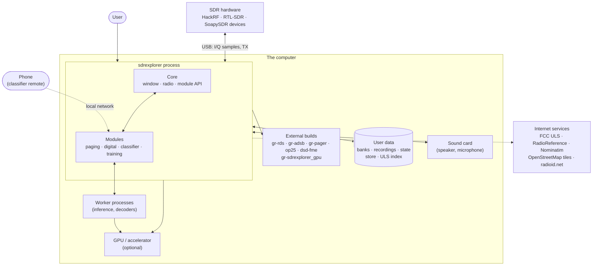

Nothing needs the network to receive. The internet is used only for data imports and lookups the user
starts (FCC downloads, RadioReference, geocoding a place name), the live map's tiles, and DMR id lookups in
the digital module.

## 3. Processes

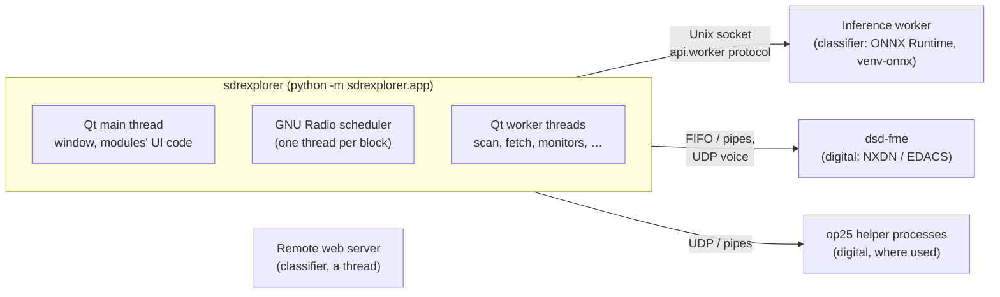

- The **app process** holds the window, the GNU Radio flowgraph and every module's Python code.
- Code that is heavy, crash-prone or needs another Python environment runs in **child processes**. The
  classifier's inference runs in a worker process using `api.worker` (its own numpy and runtime, so the
  app's GNU Radio numpy stays untouched). The digital module runs dsd-fme as a subprocess. Children exit
  when the app does.

## 4. Inside the core

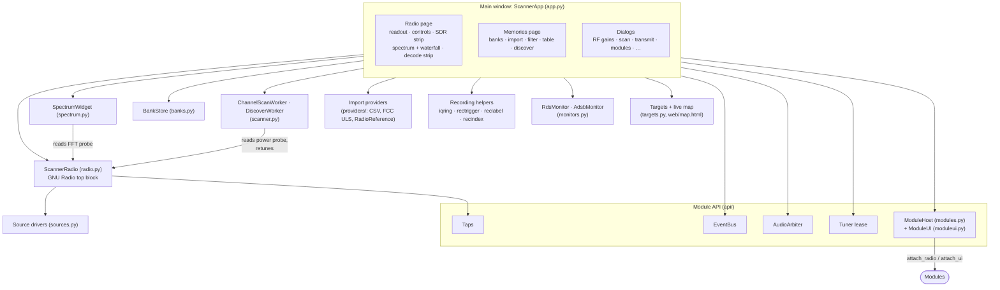

`ScannerApp` (in `app.py`) is the hub. It owns the radio, the widgets, the banks and the API objects, and
it is the only place that wires them together. `ScannerRadio` knows nothing about Qt; `SpectrumWidget` only
draws what it reads from the radio's probes.

## 5. The receive flowgraph

`ScannerRadio` is a GNU Radio `top_block`. Everything downstream of the source is built once and stays;
`start()` / `stop()` only connect or disconnect the source, so stopping releases the SDR.

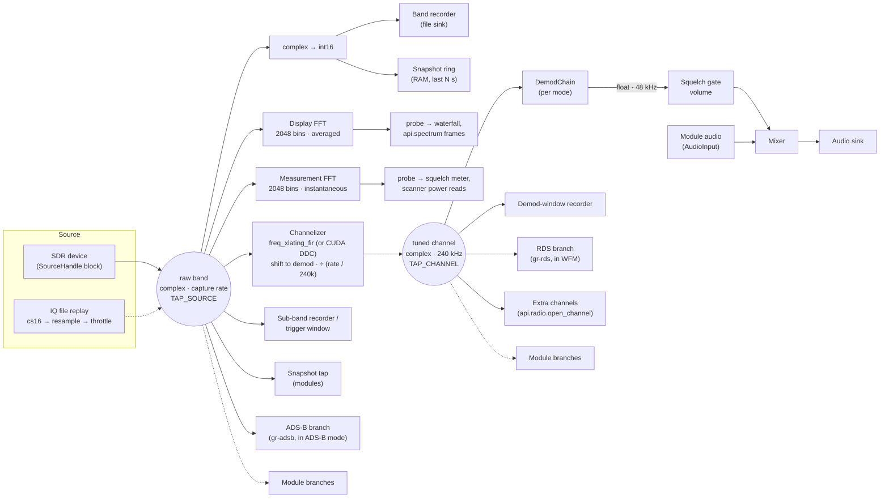

Fixed rates:

| Stage | Rate | Constant (`radio.py`) |
|---|---|---|
| capture | 2.4, 4.8, 9.6, 14.4 or 19.2 Msps: a fixed list (the HackRF's range), offered where the device accepts the rate | `SAMP_RATE_OPTIONS` |
| tuned channel | 240 kHz | `QUAD_RATE` |
| audio | 48 kHz | `AUDIO_RATE` |
| FFT probes | 2048 bins | `NFFT` |

Faster devices (a LimeSDR, a USRP) are limited to 19.2 Msps for now: the list, the 2048-bin FFT and the snapshot ring
are sized for it.

Every capture rate is a multiple of 240 kHz, so only the channelizer's decimation changes with the rate; the
demod chains and everything after them never do. A rate change stops the radio, rebuilds the channelizer
and both FFT probes, and re-points every block attached to the channel (the core's and modules').

**Demod chains** (`DemodChain`, one per mode, swapped under the flowgraph lock on a mode change):

| Kind | Chain |
|---|---|
| `wfm` | quadrature demod at 240 kHz → resample to 48 kHz → de-emphasis (75 µs) |
| `fm` (NFM) | channel low-pass + decimate to 48 kHz → quadrature demod → de-emphasis; with `tones`, also the CTCSS tone squelch and the blind tone-decode probe |
| `am` | channel low-pass + decimate → magnitude → DC block (strips the carrier) → AGC |
| `ssb` | one-sided complex band-pass (300 Hz low cut) + decimate → real part → AGC |
| `cw` | decimate → narrow filter around the carrier → BFO at the pitch (700 Hz default) → real part → AGC |
| `silent` | keep one in five → zeros (a module mode with its own audio) |

**The two FFT probes** both read the raw band. The display probe averages (smooth waterfall) and feeds the
spectrum widget and `api.spectrum`. The measurement probe is instantaneous, so after a retune its reading
holds only the new frequency. The scanner, the signal meter and the squelch read it.

**Optional branches** come and go with the mode: RDS while WFM is picked (if gr-rds is installed), the
ADS-B decoder while ADS-B is picked (the radio parks at 1090 MHz, and module branches are suspended to free
the CPU).

**GPU path.** With `gr-sdrexplorer_gpu` built and an NVIDIA GPU present, the channelizer is a CUDA
multichannel DDC and both FFT probes run on cuFFT. Same maths and same outputs; `--no-gpu` forces the CPU
blocks.

## 6. Tuning: band center and demod frequency

The radio keeps two frequencies:

- **band center**: where the hardware is tuned; the middle of the waterfall;
- **demod frequency**: the channel being listened to, anywhere inside the band.

```
   band center (hardware LO, DC spike)          demod frequency
            │                                         │
   ─────────┼──────────────── OFFSET (300 kHz) ───────┼──────────
   |◄─────────────────── captured band (capture rate) ─────────────────►|
```

| Action | Moves | Waterfall | Called |
|---|---|---|---|
| Type a frequency, digit click (≥ 1 kHz steps), recall a memory, scan stop | both: band center = target − 300 kHz | recenters | primary retune (`set_frequency`) |
| Click the waterfall, 100 / 10 / 1 Hz digit steps | demod only (channelizer shift) | stays | `set_demod` |

A primary retune puts the target 300 kHz above the hardware center, away from the DC spike most SDRs have
at their center frequency. Moving only the demod keeps the waterfall, the modules' extra channels and a
decoder's lock intact.

Who may recenter the band on their own is decided by the [tuner lease](module-api.md#13-tuner-lease-uituner):
the user always, otherwise the holder (a scan, ADS-B, a module's search).

## 7. Audio path and the squelch gate

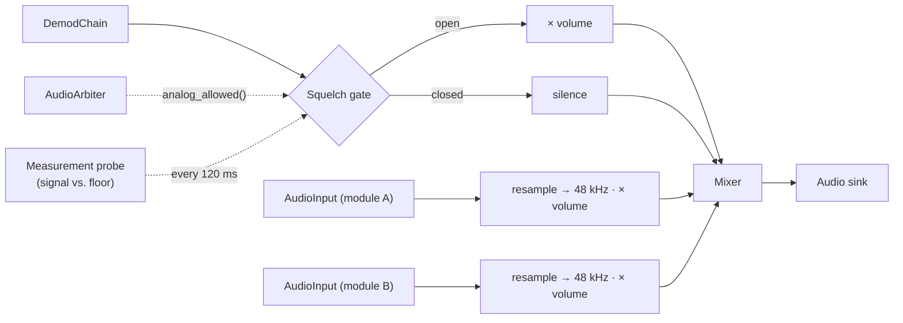

The squelch is not a GNU Radio block. Every 120 ms the window reads the channel power from the measurement
probe, compares it with the squelch level (manual, or auto: floor + margin), applies CTCSS tone squelch if
set, and asks the `AudioArbiter` whether analog may play at all. Analog is muted while any module claims the
speaker or asks for analog off. Module audio inputs are mixed **after** the gate, so a digital decoder's
voice plays even though the analog squelch is closed.

## 8. The transmit flowgraph

Transmit builds a separate `TxChain` top block for each PTT press. The receiver stops while it runs (most
SDRs are half-duplex) and restarts afterwards.

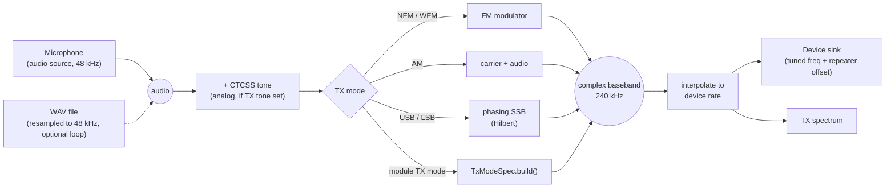

Guards in the window, before a chain is built: the device must report a transmitter (`Caps.tx`), and the
frequency must be inside a US amateur band unless the user has ticked the override in Settings ▸ Transmit.

## 9. Threads

| Thread | What runs there |
|---|---|
| **Qt main thread** | the window, every widget, every `Module` hook, bus handlers, `api.spectrum` callbacks, the squelch poll (120 ms), the state autosave (15 s) |
| **GNU Radio scheduler** (one per block) | every block's `work()`, the core's and modules' |
| `ChannelScanWorker`, `DiscoverWorker` | stepping through channels or a frequency range, reading the measurement probe |
| `FetchWorker`, `GeocodeWorker`, `DownloadWorker` | imports, geocoding, FCC downloads |
| `IndexWorker`, `SearchWorker` | FCC license search (index build, queries) |
| `RdsMonitor`, `AdsbMonitor` | drain a decoder queue filled in a scheduler thread and emit Qt signals |
| `SnapshotWriter`, `TxWatcher` | write a snapshot to disk; watch a transmit file for its end |
| Module threads | each module's own (queue drainers, searches, a web server) |

The rule that keeps this safe: **only the Qt main thread touches widgets.** Data from a scheduler or worker
thread travels through a `queue.Queue` and a Qt signal ([module API §5](module-api.md#5-threads)).

Two things do run off the main thread and are documented as such: `api.radio.on_retune` callbacks (on
whatever thread tuned) and `AudioInput.write()` (any thread).

## 10. The module system

### Discovery and loading

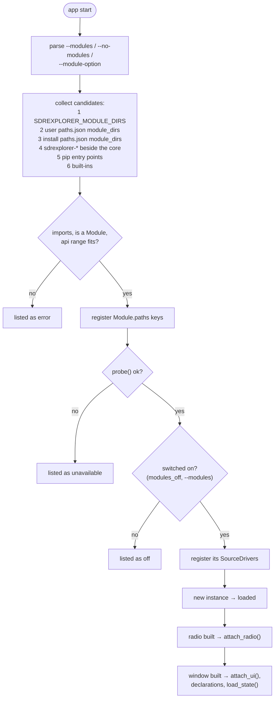

The proofs entry point (`sdrexplorer.proofs`) is read from the same checkouts and installed packages, but
lazily and without loading the module, so headless tools (the training pipeline) can use proofs too.

### What the core gives each module

`ModuleHost` (`modules.py`) holds the loaded modules and calls their hooks, each wrapped so an exception is
reported and contained. Each module gets its own `ModuleUI` (`moduleui.py`), the `ui` object, so everything
it adds is recorded as its own. Shared objects (`EventBus`, `AudioArbiter`, `Tuner`, `Taps`) live in
`api/` and are created once by the window.

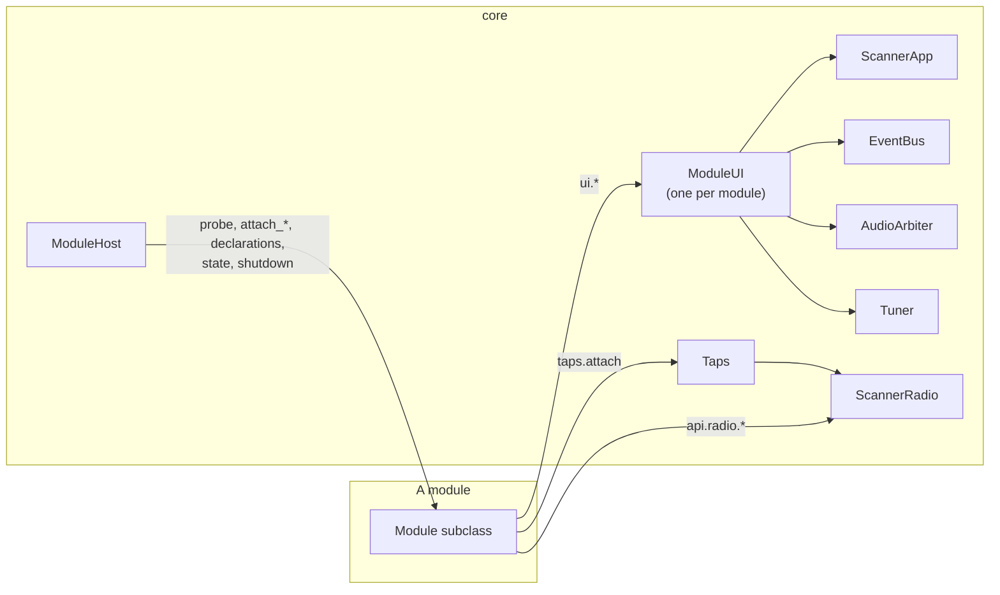

## 11. How a decode reaches the screen

A typical decoder module, from samples to the log, using the paging module's POCSAG decoder as the
example:

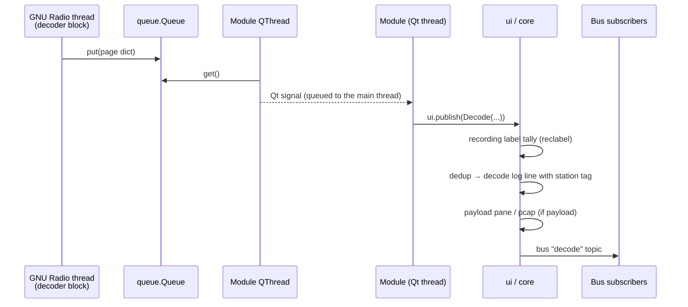

The station tag in the log comes from matching the record's `ids` against the tone codes stored on the
user's memory channels. The tally makes every IQ recording made while a decoder runs carry a `decoded`
label in its sidecar ([§12](#12-recording-snapshots-and-replay)).

## 12. Recording, snapshots and replay

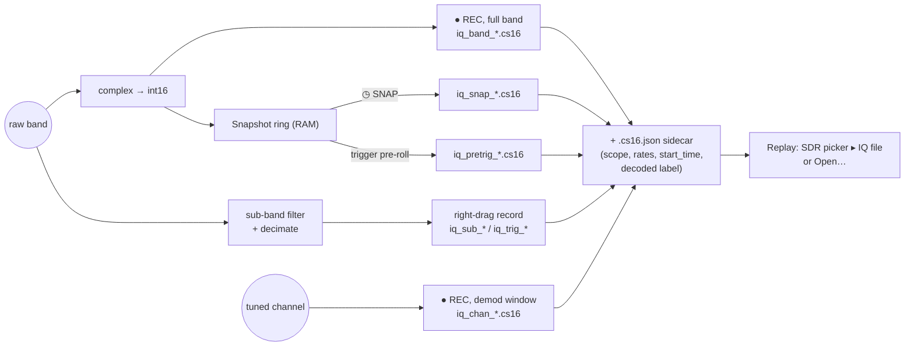

- **Format:** interleaved signed 16-bit I/Q (`cs16`, scale 32767), which most SDR tools read. Every file
  has a JSON sidecar `<name>.cs16.json` ([user manual: recording file format](user-manual.md#recording-file-format)).
- **Snapshot ring** (`iqring.py`): the last N seconds of the band in RAM (default 10 s, Settings ▸ IQ
  snapshot). ◷ SNAP writes it out plus 2 s after the click. Each band move marks the ring, so a snapshot
  only holds samples of the band it is labeled with.
- **Trigger** (`rectrigger.py`): watches a selected window's level and records each transmission as its
  own file, with the seconds before it taken from the ring.
- **Labels** (`reclabel.py`): while a recording runs, every `Decode` record is tallied; the dominant
  protocol is written into the sidecar under `decoded`.
- **Replay:** the file becomes the source, resampled to a capture rate and throttled to real time.
  Everything downstream (waterfall, demod, modules) works as with a live device. The band center is fixed
  by the file; tuning moves only the demod.

## 13. Files and folders

User data lives outside the program, so the install can be read-only.

| Folder (Linux default) | Paths key | Contents |
|---|---|---|
| `~/.local/share/sdrexplorer/` | `data_dir` | the root of everything below |
| `…/memory/` | `memory_dir` | `state.json` (session: frequency, mode, gains, window, modules' sections), `banks.json` (memories), `sources.json` + `sources_caps.json` (per-device settings and learned capabilities), `geocode_cache.json`, modules' caches and logs |
| `…/recordings/` | `recordings_dir` | IQ recordings and sidecars; users sort them into subfolders by mode |
| `…/uls/` | `uls_dir` | FCC ULS downloads and `uls_index.sqlite` |
| `…/realdata/` | `store_dir` | the real-data store of labeled examples ([format](realstore-format.md)) |
| `~/.config/sdrexplorer/` | `config_dir` | `paths.json` (the user's paths and module folders, `modules_off`), `secrets.json` (mode 0600), `station.json`, `config.json` (legacy RadioReference settings) |

macOS keeps both data and config in `~/Library/Application Support/sdrexplorer`. Windows keeps data in
`%LOCALAPPDATA%\sdrexplorer` and config in `%APPDATA%\sdrexplorer`. `XDG_DATA_HOME` / `XDG_CONFIG_HOME` are
honored on Linux. A
**portable** install (`--portable`, `SDREXPLORER_PORTABLE=1`, or a file named `portable` in the install
folder) keeps all of it under `<install>/data/`.

Writes are atomic (write a temporary file, then rename) for `state.json`, `banks.json`, `secrets.json`,
`station.json` and the store's `held_out.json`.

## 14. Path resolution

`paths.py` resolves every external build, interpreter and data folder by key, first match wins:

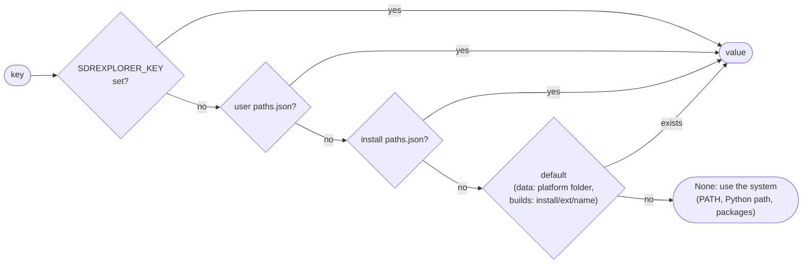

`./run_sdrexplorer.sh --paths` (or `python3 -m sdrexplorer.paths`) prints every key, its value and where it
came from, followed by the optional features and whether each is available. Relative paths in a
`paths.json` are relative to that file. See [`paths.example.json`](../paths.example.json).

## 15. Source tree

```
sdrexplorer/                  repository root
  sdrexplorer/                the package
    app.py                    main window (ScannerApp), menus, dialogs, all wiring; main()
    radio.py                  ScannerRadio (receive flowgraph), DemodChain, TxChain, modes, ham bands
    spectrum.py               SpectrumWidget: spectrum + waterfall, markers, labels, overlays
    sources.py                the core SDR driver (gr-osmosdr / SoapySDR), per-device settings
    banks.py                  Channel, Bank, BankStore: memories and banks.json
    scanner.py                ChannelScanWorker (stop-on-active scan), DiscoverWorker (peak sweep)
    fetch.py                  import / geocode / FCC download workers; registers the core importers
    providers/                base (FoundChannel, geofence), csv_import, fcc_uls, radioreference, geocode
    ulsui.py                  FCC license search window
    iqring.py                 the snapshot ring buffer
    rectrigger.py             signal-triggered sub-band recording
    reclabel.py               decoder-derived labels in recording sidecars
    recindex.py               which frequencies already have recordings (the ▼ marks)
    rds.py                    RDS field accumulation (WFM)
    monitors.py               RDS / ADS-B queue drainers
    targets.py                positions for the live map; web/map.html + vendored Leaflet
    pcap.py                   pcap export of payloads
    paths.py                  path resolution, data folders, module folders
    contribute.py             cut a signal out of a recording for sharing (no frequency / time / position); ingest
    features.py               optional core features and whether each is available
    modules.py                module discovery, API-range check, ModuleHost
    moduleui.py               ModuleUI (the `ui` handle), Settings ▸ Modules dialog
    api/                      the module API (see module-api.md)
      __init__.py             public names, API_VERSION
      module.py               Module, ModeSpec, DemodSpec, TxModeSpec, MenuEntry, Overlay, Panel
      records.py              Decode, Position, Annotation
      taps.py, radio.py       tap points; radio functions
      audio.py                AudioArbiter, AudioInput
      events.py, ext.py       EventBus; extension registries
      tuner.py                the tuner lease
      sources.py              SourceDriver, Caps, GainStage, DeviceInfo, SourceHandle
      spectrum.py             SpectrumFrame, subscribe
      worker.py               out-of-process workers (app side)
      worker_server/          sdrexplorer_worker.py (worker side, standard library only)
      importers.py, station.py, secrets.py, store.py, proofs.py
      testing.py              FakeRadio, FakeUI, fake SDR devices
    tests/                    core tests
    samples/                  sample CSV channel lists for the import
    verify_hw.py              headless hardware smoke test
  gr-sdrexplorer_gpu/         optional CUDA out-of-tree module (C++/CUDA, CMake)
  examples/sdrexplorer-activity/   example module
  docs/                       documentation (docs/images: the screenshots, made by tools/demo.py)
  tools/demo.py               demo mode: a synthetic band and made-up decodes, no SDR; --shots makes the screenshots
  install.sh, install.py      the Debian / Ubuntu installer (install.json: the core's packages, extras, module repos)
  patches/                    patches for the core's external builds (gr-osmosdr, gr-rds)
  environment.yml             conda environment
  pyproject.toml              package metadata
  run_sdrexplorer.sh / .bat   launchers
  paths.example.json          example paths.json
```

## 16. Tests

| Test | Covers | Run |
|---|---|---|
| `sdrexplorer/tests/test_modules.py` | module discovery, API ranges, every API path, in the real window | `QT_QPA_PLATFORM=offscreen python3 -m sdrexplorer.tests.test_modules` |
| `sdrexplorer/tests/test_ui_restructure.py` | the window: views, menus, tuning, scan, recording, replay, transmit guards | `QT_QPA_PLATFORM=offscreen python3 -m sdrexplorer.tests.test_ui_restructure` |
| `sdrexplorer/tests/test_iqring.py` | the snapshot ring | `python3 -m sdrexplorer.tests.test_iqring` |
| `sdrexplorer/tests/test_contribute.py` | sharing crops: only the signal, no metadata; ingest refuses tampered packages | `python3 -m sdrexplorer.tests.test_contribute` |
| `sdrexplorer/tests/test_install.py` | install.json and the modules' module.json; a dry-run install (the full test is an install in a clean container) | `python3 -m sdrexplorer.tests.test_install` |
| `sdrexplorer/tests/test_core_generic.py` | the core names no moved-out module | `python3 -m sdrexplorer.tests.test_core_generic` |
| `sdrexplorer/verify_hw.py` | a real SDR: I/Q flow, power reads, mode switches, retune | `python3 -m sdrexplorer.verify_hw` (hardware attached) |
| `gr-sdrexplorer_gpu/test_*.py` | the CUDA blocks against the CPU ones | see its README |
| `examples/sdrexplorer-activity/tests/` | the example module | see the [tutorial](module-tutorial.md#10-test-it) |

Run from the repository root. The window tests use Qt's offscreen platform and stub the SDR, so they need
no hardware or display. Every user-data path goes to a temporary folder (`paths.override`). Each module
repository has its own tests, run against a core checkout beside it.

## 17. Design rules

1. **The core is a complete analog receiver on its own.** A feature with dependencies the core doesn't
   need goes in a module.
2. **The core names no module.** Labels, protocols and topics are opaque strings. Modules find each other by
   capability (a label they decode, a topic, a request, a registry), and work when the others are absent.
   `test_core_generic.py` enforces this.
3. **Nothing is hard-coded to one machine.** Every external path is a key ([§14](#14-path-resolution)).
   User data lives outside the program.
4. **One failing part never takes down the rest.** Module hooks, bus handlers, overlays and spectrum
   subscribers are wrapped; risky native code runs in worker processes.
5. **Only the Qt main thread touches widgets.**
6. **The UI follows the device's reported capabilities**, never its name: rates, gain stages, PPM and PTT
   come from `Caps`.
7. **Every optional feature switches itself off** when its library is missing, and says why (Settings ▸
   Modules lists the core features and the modules with their status).
