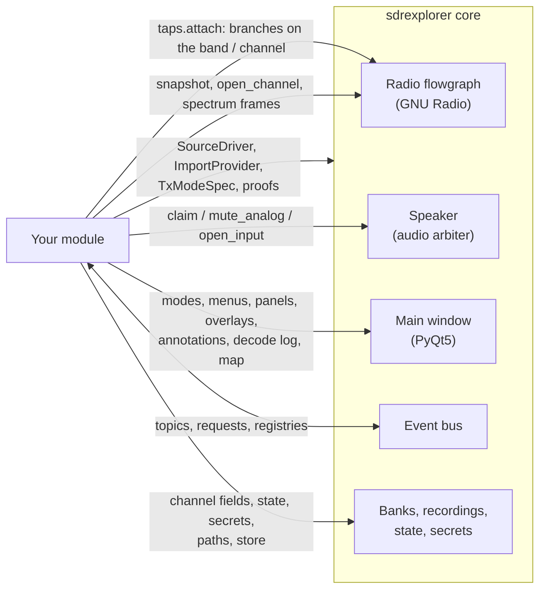
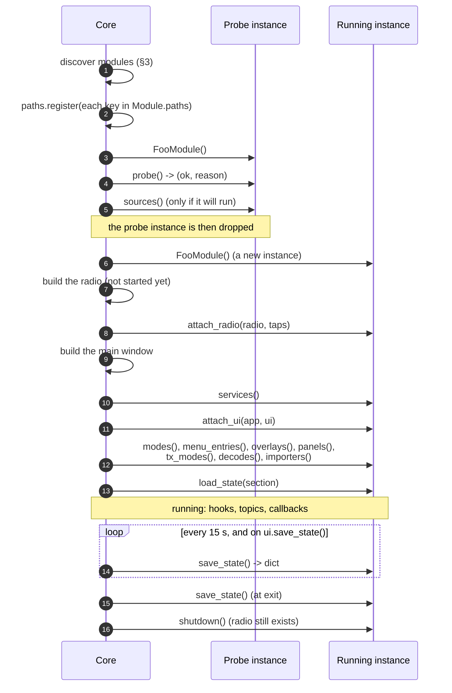
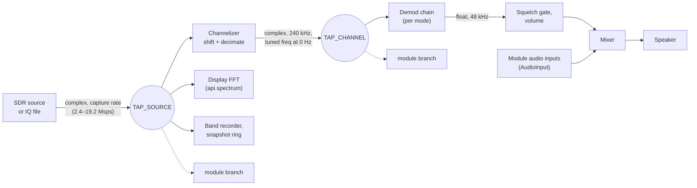
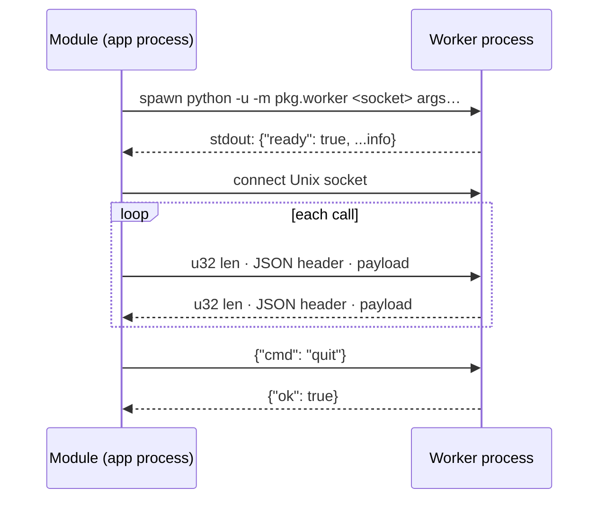
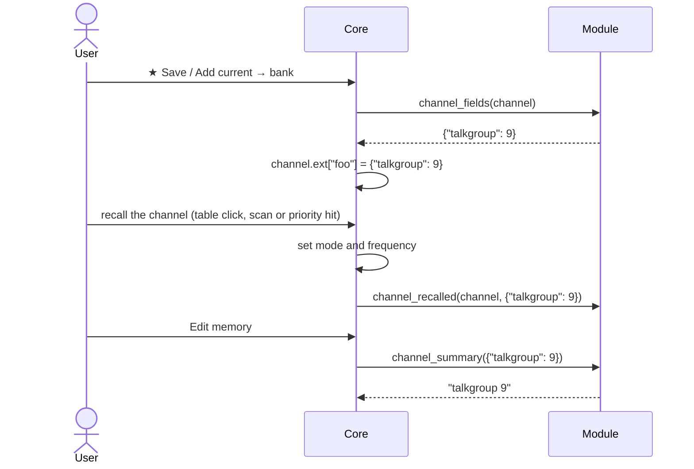

# sdrexplorer module API reference

**Module API 1.0** (`sdrexplorer.api.API_VERSION == (1, 0)`), first shipped with sdrexplorer 1.0.0.

This is the full contract between the sdrexplorer core and a module. If you are writing your first module,
start with the [tutorial](module-tutorial.md), which builds a working one step by step. Come back here for
the details of each call.

Contents:

1. [Concepts](#1-concepts)
2. [Packaging a module](#2-packaging-a-module)
3. [How the core finds and loads modules](#3-how-the-core-finds-and-loads-modules)
4. [Lifecycle](#4-lifecycle)
5. [Threads](#5-threads)
6. [`Module` reference](#6-module-reference)
7. [`ui`: the module's handle on the core](#7-ui-the-modules-handle-on-the-core)
8. [Declarations: modes, transmit modes, menus, panels, overlays](#8-declarations)
9. [Records: `Decode`, `Position`, `Annotation`](#9-records-decode-position-annotation)
10. [Signal: tap points and the radio](#10-signal-tap-points-and-the-radio)
11. [Audio](#11-audio-uiaudio)
12. [The bus: topics, requests, registries](#12-the-bus-topics-requests-registries)
13. [Tuner lease](#13-tuner-lease-uituner)
14. [SDR sources](#14-sdr-sources-apisources)
15. [Spectrum frames](#15-spectrum-frames-apispectrum)
16. [Out-of-process workers](#16-out-of-process-workers-apiworker)
17. [Import providers](#17-import-providers-apiimporters)
18. [Bank channels](#18-bank-channels-channelext)
19. [Station: location and time](#19-station-apistation)
20. [Secrets](#20-secrets-apisecrets)
21. [Paths](#21-paths-apipaths)
22. [Decoder proofs](#22-decoder-proofs-apiproofs)
23. [Real-data store](#23-real-data-store-apistore)
24. [Testing a module](#24-testing-a-module)
25. [Versioning and compatibility](#25-versioning-and-compatibility)
26. [Changelog](#26-changelog)

---

## 1. Concepts

A **module** is a Python package in its own repository that adds features to sdrexplorer: decoders, modes,
panels, waterfall labels, SDR drivers, import sources, transmit modes. Modules exist so that a feature with
heavy or platform-specific dependencies (op25, an inference runtime, a vendor SDK) never becomes a
dependency of the core. A user installs only the modules they want.

Three rules shape the API.

**1. Modules import only `sdrexplorer.api`.** Everything else under `sdrexplorer.*` is private and can
change in any release. If you need something the API doesn't offer, open an issue rather than reach into
the core. The one exception is `sdrexplorer.api.paths`, which is the core's `paths` module re-exported.

**2. The core names no module.** The core never says "P25", "POCSAG" or "classifier". Labels, protocols,
mode names and topic names are opaque strings that the core routes and displays without interpreting them.
A test (`sdrexplorer/tests/test_core_generic.py`) fails if the words of a moved-out module appear in the
core's code. In practice:

- one module hands a signal to another by **label** (`request_decode("POCSAG", ...)`), without knowing
  which module (if any) decodes it;
- modules talk through **topics**, **requests** and **registries** on a shared bus, named with an owner
  prefix (`"classifier.detections"`);
- if nobody answers, nothing happens. A module must work when the others are not installed.

**3. A failing module must not take down the app.** Every hook the core calls is wrapped: an exception is
printed to stderr with the module's name, and the core and the other modules carry on. Bus handlers and
spectrum callbacks are wrapped the same way. Heavy or crash-prone native code belongs in a separate process
([workers](#16-out-of-process-workers-apiworker)).

What a module can plug into:



## 2. Packaging a module

A module is an ordinary Python project. The recommended layout:

```
sdrexplorer-foo/
  pyproject.toml              entry points (required)
  module.json                 metadata for the install script (recommended)
  README.md                   what it adds, how to install its external builds
  LICENSE
  src/sdrexplorer_foo/
    __init__.py               __version__
    module.py                 class FooModule(sdrexplorer.api.Module)
    proofs.py                 optional: decoder proofs (no Qt, no GNU Radio)
    worker.py                 optional: an out-of-process worker
  tests/
  patches/                    optional: patches for the external builds it needs
```

Name the repository `sdrexplorer-<something>`. A folder with that prefix next to the core checkout is found
without any configuration (see [§3](#3-how-the-core-finds-and-loads-modules)).

### `pyproject.toml`

The entry point is what makes a package a module:

```toml
[project]
name = "sdrexplorer-foo"
version = "1.0.0"
requires-python = ">=3.11"
dependencies = ["numpy>=1.24"]       # only what pip can install into the app's Python

[project.entry-points."sdrexplorer.modules"]
foo = "sdrexplorer_foo.module:FooModule"

# optional: headless decoder proofs (§22)
[project.entry-points."sdrexplorer.proofs"]
foo = "sdrexplorer_foo.proofs:PROOFS"     # a dict {label: fn}, or a callable returning one

[tool.setuptools.packages.find]
where = ["src"]
```

- The entry-point name (`foo`) should equal the class's `Module.name`.
- One package may register several modules (several lines in the table).
- For a checkout that is not pip-installed, the core reads this table directly from `pyproject.toml` with
  `tomllib`, which needs **Python 3.11 or later**. Installed packages work on any Python the core supports.
- Do not list GNU Radio, PyQt5 or numpy versions that conflict with the core's environment. The app's
  Python has GNU Radio 3.10 with numpy 1.26. A dependency that needs another numpy belongs in a
  [worker](#16-out-of-process-workers-apiworker) under its own venv.

### `module.json`

Read by the install script (`install.sh` in the core, Debian / Ubuntu) and by people, never by the app. It
says what the module needs from the system and how to build its external parts, so the core's installer can
set it up without knowing anything about it:

```json
{
  "name": "foo",
  "title": "Foo decoder",
  "api": ">=1.0,<2.0",
  "pip": ["numpy>=1.24"],
  "apt": ["python3-requests"],
  "ext": [
    {
      "name": "libbar",
      "for": "the vocoder libfoo links",
      "repo": "https://example.org/libbar.git",
      "commit": "30dc790",
      "build": {"system": "cmake", "args": ["-DCMAKE_BUILD_TYPE=Release"]},
      "install_into": "libfoo",
      "optional": true
    },
    {
      "key": "libfoo",
      "name": "libfoo",
      "for": "the FOO-1200 decoder",
      "repo": "https://example.org/libfoo.git",
      "commit": "a2cfb66",
      "patches": ["patches/libfoo-gnuradio-3.10.patch"],
      "build": {"system": "cmake", "subdir": "", "args": ["-DCMAKE_BUILD_TYPE=Release"]},
      "apt": ["libsndfile1-dev"],
      "paths": {"foo_apps": "{src}/apps"},
      "optional": true
    }
  ],
  "venvs": [
    {"dir": "venv-foo", "for": "the inference worker", "pip": ["onnxruntime>=1.16"], "path_key": "foo_python"}
  ],
  "platforms": ["linux", "darwin", "win32"]
}
```

| Key | Meaning |
|---|---|
| `name` | the module's `Module.name` |
| `title` | human-readable name |
| `api` | the same range as `Module.api`; the installer refuses a module whose range doesn't take the core's version |
| `pip` | Python requirements of the module itself (the installer relies on the distribution's packages for these; list them in `apt` too) |
| `apt` | Debian / Ubuntu packages the module needs at run time |
| `ext` | external builds, built in list order (see below) |
| `venvs` | separate Python environments for workers: `dir` under the install folder, `pip` packages, and the `path_key` the installer writes into `paths.json` (pointing at its `bin/python`) |
| `platforms` | `sys.platform` values it supports |

An `ext` entry:

| Key | Meaning |
|---|---|
| `key` | the [paths key](#21-paths-apipaths) the module reads. The build is installed into `<install>/ext/<key with _ as ->`, where the key resolves by default, so nothing needs writing to `paths.json` |
| `name`, `for` | shown while installing and in failure messages |
| `repo`, `commit` | upstream, and the commit it is pinned to (tested with the module) |
| `patches` | patch files in the module repo, applied with `git apply` to the pinned commit |
| `build` | `{"system": "cmake", "subdir": …, "args": […]}`: configured with `CMAKE_INSTALL_PREFIX` set to its folder and `CMAKE_PREFIX_PATH` to every build before it; or `{"system": "none"}`: cloned only (Python sources, data) |
| `apt` | Debian / Ubuntu packages needed to build it |
| `paths` | extra `paths.json` entries; `{src}` is its source folder, `{prefix}` its install folder, `{install}` the install folder |
| `install_into` | no key of its own: installed into another entry's folder (a library that entry links), which must come later in the list |
| `optional` | a failed optional build is reported and the rest of the install carries on |

The installer skips an entry already built at the same commit, patches and recipe, so it can be re-run.

## 3. How the core finds and loads modules

### Discovery

At start-up the core collects module classes from these places. When two have the same name, the first
one found wins.

| # | Where | Source shown in Settings ▸ Modules |
|---|---|---|
| 1 | Folders in the environment variable `SDREXPLORER_MODULE_DIRS` (`:`-separated; `;` on Windows) | environment |
| 2 | Folders the user added in **Settings ▸ Modules ▸ Add module…** (`module_dirs` in the user's `~/.config/sdrexplorer/paths.json`) | added |
| 3 | `module_dirs` in the install's `paths.json` (written by the install script) | install |
| 4 | Every `sdrexplorer-*` folder that has a `pyproject.toml` and sits next to the core checkout | beside the core |
| 5 | Installed packages' `sdrexplorer.modules` entry points (`pip install`) | installed (pip) |
| 6 | Classes built into the core (features waiting to move out; none at present) | built in |

For 1–4 (checkouts), the entry points are read from `pyproject.toml`, and the checkout's `src/` (or the
folder itself when there is no `src/`) is put on `sys.path`. A clone works without `pip install -e`.

Two more variables are for tests and packagers: `SDREXPLORER_MODULE_DIRS_ONLY` replaces the whole list of
checkout folders, and `SDREXPLORER_SKIP_BESIDE=1` skips step 4. `python3 -m sdrexplorer.paths` lists the
module folders that were found and where each came from.

**Add module…** checks a folder before remembering it. The folder must have a `pyproject.toml` that declares
`sdrexplorer.modules` entry points, and each one must import to a `Module` subclass whose `api` range
includes the core's version. Otherwise the reason is shown and nothing is saved.

### Which modules run

A module runs when all of these hold:

1. its class imports and is a subclass of `sdrexplorer.api.Module`;
2. its `api` range includes the core's `API_VERSION`;
3. `probe()` returns `(True, "")`;
4. the user has not switched it off in Settings ▸ Modules (stored as `modules_off` in the user's
   `paths.json`).

The command line overrides 4 for one run: `--modules a,b` runs exactly those modules, and `--no-modules`
runs none. Changes in Settings ▸ Modules take effect at the next start, because a module's branches, menus
and panels are built once, during start-up.

Settings ▸ Modules shows every module found with its status: `loaded`, `off`, `unavailable: <probe reason>`,
or `error: <import or API problem>`.

## 4. Lifecycle



Points that matter in practice:

- **`probe()` runs on a separate, throw-away instance.** It is also called for modules the user has
  switched off, so Settings ▸ Modules can show why a module is unavailable. Keep it free of side effects,
  and don't store anything on `self` in `probe()` expecting to find it later: the instance that runs is a
  new one. (`Module.paths` is registered before `probe()`, so `paths.get(key)` works inside it.)
- **`sources()` is called during discovery**, on the probe instance, before the radio exists, so the
  first device search already includes the module's drivers.
- **`attach_radio()` comes before `attach_ui()`**, and the radio is not running yet when it is called.
  Build branches now or later; [tap points](#10-signal-tap-points-and-the-radio) remember what is attached
  and connect it when the radio starts.
- **The declaration methods** (`modes()`, `menu_entries()` …) are called **once**, right after
  `attach_ui()`. Later changes go through `ui.add_mode()`, `ui.add_menu_entry()`, `ui.add_overlay()` or
  `ui.add_panel()`.
- **`load_state(d)`** comes after the declarations, so a module can apply saved settings to widgets it has
  already created. `d` is `{}` the first time.
- **`shutdown()`** runs while the radio still exists, so it can detach its branches and stop its threads.
  It runs after the last `save_state()`.

## 5. Threads

sdrexplorer is a PyQt5 application with a GNU Radio flowgraph, so code runs on several threads. Qt widgets
may be touched **only on the Qt main thread**.

| Code | Thread |
|---|---|
| Every `Module` hook (`attach_*`, declarations, `load_state`, `save_state`, `shutdown`, `context_entries`, `channel_*`) | Qt main thread |
| `ModeSpec.enter` / `leave`, `MenuEntry.triggered` / `toggled`, `Panel.factory`, `Overlay.paint` | Qt main thread |
| `decodes()` handlers (via `request_decode`) | the caller's thread, normally the Qt main thread |
| Bus topic handlers and request providers | the publisher's / requester's thread. The core publishes on the Qt main thread; **publish from a worker thread only through a Qt signal** |
| `api.spectrum` callbacks | Qt main thread |
| `api.radio.on_retune` callbacks | the thread that tuned, **often not** the Qt main thread |
| `ImportProvider.run` | a worker thread |
| GNU Radio blocks in your branch (`work()`) | GNU Radio scheduler threads |
| `AudioInput.write()` | any thread |
| `api.radio.snapshot()` / `ui.snapshot()` | blocks until the samples arrive: call it **off** the Qt thread |

The usual pattern, used by every module so far, moves data from a flowgraph or reader thread to the Qt
thread through a queue and a signal:

```python
class _Monitor(QtCore.QThread):
    item = QtCore.pyqtSignal(dict)

    def __init__(self, q):
        super().__init__()
        self._q, self._keep = q, True

    def run(self):                       # a Qt worker thread
        while self._keep:
            try:
                d = self._q.get(timeout=0.1)  # filled by a GNU Radio block's work()
            except queue.Empty:
                continue
            self.item.emit(d)            # delivered on the Qt main thread

    def stop(self):
        self._keep = False

# in the module:
self._mon = _Monitor(branch.q)
self._mon.item.connect(self._on_item)    # _on_item runs on the Qt thread: safe to call ui.publish()
self._mon.start()
```

## 6. `Module` reference

```python
from sdrexplorer.api import Module

class FooModule(Module):
    name = "foo"
    title = "Foo decoder"
    version = "1.0.0"
    api = ">=1.0,<2.0"
    paths = {"libfoo": "libfoo install prefix (FOO decode)"}
    min_frames = 5
```

### Class attributes

| Attribute | Type | Default | Meaning |
|---|---|---|---|
| `name` | `str` | `""` | Unique short id: the key of the module's section in `state.json`, of its fields on bank channels (`Channel.ext`), of its secrets, and of its row in Settings ▸ Modules. Use lowercase, no dots. **Never change it after release**: saved state is keyed by it. |
| `title` | `str` | `""` | Shown in Settings ▸ Modules and in tooltips. |
| `version` | `str` | `"0"` | The module's own version, shown in Settings ▸ Modules. |
| `api` | `str` | `">=1.0,<2.0"` | The core API versions this module works with: comma-separated comparisons (`>=`, `>`, `<=`, `<`, `==`, `!=`) on `major.minor`. The core refuses to load the module outside this range. See [§25](#25-versioning-and-compatibility). |
| `paths` | `dict[str, str]` | `{}` | The module's own [path keys](#21-paths-apipaths) and what each is for. Registered before `probe()`. |
| `min_frames` | `int` | `5` | How many `Decode` records of one protocol a running IQ recording must collect before it is labeled with that protocol. |

### Instance attributes

| Attribute | Set by | |
|---|---|---|
| `self.radio` | `Module.attach_radio` | the core's radio object. Pass it to `api.radio` functions; don't use its attributes directly. |
| `self.app` | `Module.attach_ui` | the main window. Pass it on when a callback asks for it (`ModeSpec.enter(app)`); don't use its attributes directly. |

If you override `__init__`, `attach_radio` or `attach_ui`, call `super()` so these get set.

### Hooks

| Hook | Called | Return | Purpose |
|---|---|---|---|
| `probe(self)` | at discovery, on a throw-away instance, for every module including switched-off ones | `(ok: bool, reason: str)` | Check the module's own dependencies (an import, a library, a path key). No side effects. `reason` is shown grayed out in Settings ▸ Modules. |
| `sources(self)` | at discovery, if the module will run | `[api.sources.SourceDriver]` | SDR drivers this module adds ([§14](#14-sdr-sources-apisources)). |
| `attach_radio(self, radio, taps)` | radio built, not yet started | — | Keep `taps` ([§10](#10-signal-tap-points-and-the-radio)). Build flowgraph branches now or later. |
| `services(self)` | before `attach_ui` | `{name: object}` | Legacy service lookup. Prefer [requests](#12-the-bus-topics-requests-registries). |
| `attach_ui(self, app, ui)` | main window built | — | Keep `ui` ([§7](#7-ui-the-modules-handle-on-the-core)). Subscribe to topics, provide requests. |
| `modes(self)` | once, after `attach_ui` | `[ModeSpec]` | Entries in the Mode picker ([§8.1](#81-receive-modes-modespec-and-demodspec)). |
| `menu_entries(self)` | once | `[MenuEntry]` | Menu actions ([§8.4](#84-menu-entries-menuentry)). |
| `overlays(self)` | once | `[Overlay]` | Waterfall painters ([§8.6](#86-waterfall-overlays-overlay)). |
| `panels(self)` | once | `[Panel]` | Decode-strip tabs or status-bar widgets ([§8.5](#85-panels-panel)). |
| `tx_modes(self)` | once | `[TxModeSpec]` | Transmit modes ([§8.2](#82-transmit-modes-txmodespec)). |
| `decodes(self)` | once | `{label: handler}` | Labels this module decodes ([§8.3](#83-decoding-by-label-decodes)). |
| `importers(self)` | once | `[ImportProvider]` | Memories ▸ Import sources ([§17](#17-import-providers-apiimporters)). |
| `load_state(self, d)` | after the declarations | — | `d`: this module's section of `state.json`, `{}` the first time. |
| `context_entries(self, freq_hz, annotation)` | each right-click on the waterfall | `[MenuEntry]` | Entries for the signal under the cursor ([§8.4](#84-menu-entries-menuentry)). |
| `channel_fields(self, channel)` | a bank channel is being saved | `dict` or `None` | The module's fields to store on it ([§18](#18-bank-channels-channelext)). |
| `channel_recalled(self, channel, fields)` | a bank channel was tuned | — | Re-apply the stored fields. |
| `channel_summary(self, fields)` | Edit memory shows a channel | `str` | One read-only line describing the fields. |
| `save_state(self)` | every 15 s, on `ui.save_state()`, and at exit | JSON-safe `dict` | The module's section of `state.json`. |
| `shutdown(self)` | at exit, radio still present | — | Stop threads, detach branches, close workers. |

The core keeps the saved sections of modules that are not loaded in a given run, so switching a module off
for a while does not lose its settings.

## 7. `ui`: the module's handle on the core

`attach_ui(app, ui)` receives a `ui` object, one per module. Whatever a module adds through it is recorded
as that module's. All methods are for the Qt main thread unless noted.

### Decode data and messages

| Call | Returns | |
|---|---|---|
| `ui.publish(record: Decode)` | — | Into the decode log, the payload pane, recording labels and the `decode` topic ([§9.1](#91-decode)). `record.source` defaults to the module's name. |
| `ui.publish_position(record: Position)` | — | Onto the live map and the `position` topic ([§9.2](#92-position)). |
| `ui.log(text)` | — | A plain, timestamped decode-log line. Prefer `publish(Decode(...))`. |
| `ui.status(text, ms=6000)` | — | A message in the status bar for `ms` milliseconds. |

### Control

| Call | Returns | |
|---|---|---|
| `ui.request_decode(label, freq_hz, info=None)` | `bool` | Ask whichever module decodes `label` to take the signal at `freq_hz`. `False` if none does. |
| `ui.current_mode()` | `str` | The Mode picker's current entry (a core mode or any module's). |
| `ui.set_mode(name)` | `bool` | Pick a Mode picker entry; the core enters it as if the user had clicked it. `False` if the entry doesn't exist or is unavailable. |
| `ui.tuned_hz()` | `int` | The demodulated frequency, Hz. |
| `ui.is_scanning()` | `bool` | A channel scan is running (it holds the band). |
| `ui.tx_mode()` | `str` | What PTT would transmit now: a module TX mode's name, or the analog mode. |

### Tuning

| Call | Returns | |
|---|---|---|
| `ui.tune(freq_hz, recenter=True, user=False)` | `(ok, reason)` | Tune as this module. `recenter=True` moves the band (a primary retune) and needs the [tuner lease](#13-tuner-lease-uituner), or nobody holding it. `recenter=False` moves only the demod within the band and always works. `user=True` means the user asked for it in this module's window (a table row, a button): it tunes as the user would and pre-empts any lease. |
| `ui.tune_band(center_hz, owner=None)` | `(ok, reason)` | Put the band's center at `center_hz`. Needs the lease. Refused during file replay. |
| `ui.tuner` | `api.Tuner` | The [tuner lease](#13-tuner-lease-uituner). |
| `ui.samp_rates(all_rates=False)` | `(rates, default)` | Capture rates (Hz) the current device offers; with `all_rates`, every rate the core can run at. |
| `ui.set_samp_rate(rate)` | `(ok, reason)` | Change the capture rate like the BW picker does. The radio restarts. |

### Waterfall

| Call | Returns | |
|---|---|---|
| `ui.annotate(items, trail=True)` | — | This module's labeled signals ([§9.3](#93-annotation)). Replaces its previous set. `trail=False` also drops the tags left behind by signals that stopped. |
| `ui.annotation_near(freq_hz)` | `dict` or `None` | The annotation nearest `freq_hz`, from any module. |
| `ui.set_status_box(lines)` | — | `[(text, "#rrggbb")]` in a box at the bottom right of the waterfall (performance figures and the like); `None` hides it. |
| `ui.label_style()` | `dict` | `{"font_px", "text_color", "tick_color"}` from Settings ▸ Label style, so overlays match. |
| `ui.show_annotations()` | — | Make annotations visible: View ▸ Label source "Memories" becomes "Both". |
| `ui.repaint()` | — | Redraw the waterfall now (after an overlay's data changed). |
| `ui.set_app_icon(icon)` | — | The window / taskbar icon (a `QIcon`) while something runs; `None` restores the usual one. |

### Radio

| Call | Returns | |
|---|---|---|
| `ui.snapshot(n, timeout=5.0)` | `ndarray` or `None` | The next `n` raw band samples (complex64). Blocks: call it off the Qt thread. Same as `api.radio.snapshot(radio, n, timeout)`. |

### Recordings

| Call | Returns | |
|---|---|---|
| `ui.recorded_channels()` | `[(freq_hz, label)]` | Every channel that already has recordings (recordings folders and the real-data store). The waterfall's ▼ "recorded" marks show the same. |
| `ui.recordings_changed()` | — | Files were added: rebuild the "recorded" marks. |
| `ui.label_alias(store_label, shown)` | — | Show a store label (and name its recordings folder) as `shown`, e.g. a variant under its family name. |

### Bank channels

| Call | Returns | |
|---|---|---|
| `ui.channel_fields()` | `dict` | This module's fields on the bank channel recalled last (`{}` if none, or if the user has tuned by hand since). |
| `ui.set_channel_fields(fields)` | `bool` | Replace them, and save the banks. `False` when no channel is recalled. |

### Settings and state

| Call | Returns | |
|---|---|---|
| `ui.option(key, default=None)` | `str` or `default` | A value given on the command line for this run: `--module-option <name>.<key>=<value>`. Values are strings. |
| `ui.save_state()` | — | Save the session now (every module's `save_state()` too), e.g. after a settings dialog's OK. |

### Placement

| Call | |
|---|---|
| `ui.add_mode(ModeSpec)` | Like returning it from `modes()`, at any later time. |
| `ui.add_menu_entry(MenuEntry)` | Like `menu_entries()`. Returns the entry, with `.action` set. |
| `ui.add_overlay(Overlay)` | Like `overlays()`. |
| `ui.add_panel(Panel)` | Like `panels()`. |

### Shared objects

| Attribute | |
|---|---|
| `ui.bus` | the [event bus](#12-the-bus-topics-requests-registries) |
| `ui.audio` | the [audio arbiter](#11-audio-uiaudio) |
| `ui.service(name)` | an object another module returned from `services()` (legacy; prefer requests) |

## 8. Declarations

All of these are dataclasses importable from `sdrexplorer.api`.

### 8.1 Receive modes: `ModeSpec` and `DemodSpec`

```python
from sdrexplorer.api import ModeSpec, DemodSpec

ModeSpec("FOO",
         demod=DemodSpec("fm", bw=16_000, max_dev=4_800, deemph=0.0),
         enter=lambda app: self._start(),
         leave=lambda app: self._stop(),
         available=lambda: (True, ""),
         tooltip="FOO data, 1200 bps")
```

**`ModeSpec`**: an entry in the Mode picker.

| Field | Type | Default | |
|---|---|---|---|
| `name` | `str` | required | Shown in the picker; must not clash with a core mode (`NFM AM WFM USB LSB CW ADS-B`) or another module's. A clash is reported and the second one skipped. |
| `demod` | `DemodSpec`, `str` or `None` | `None` | What you hear in this mode. A `DemodSpec` makes the core build an audio chain for it. A core mode's name (`"NFM"`) listens through that mode. `None` keeps whatever is playing. |
| `enter` | `callable(app)` or `None` | `None` | Called when the mode is picked, **after** the core has switched the audio to `demod`. Start your decode branch here. |
| `leave` | `callable(app)` or `None` | `None` | Called when another mode is picked. Stop your branch here. |
| `available` | `callable() -> (ok, reason)` or `None` | `None` | Checked when the picker is filled and when the mode is picked. An unavailable mode is listed grayed out with `reason` as its tooltip; picking it reverts the picker and shows the reason. |
| `tooltip` | `str` | `""` | Tooltip in the picker. |
| `picker` | `str` | `"mode"` | The only picker. |

The picked module mode is saved with the session and entered again at the next start, after the window
exists. A bank channel whose `mode` is a module's mode is applied through that mode.

**`DemodSpec`**: an audio path the core builds, the same way as its own modes (complex 240 kHz channel in,
float 48 kHz audio out).

| Field | Type | Default | |
|---|---|---|---|
| `kind` | `str` | `"fm"` | `"fm"`, `"wfm"`, `"am"`, `"ssb"`, `"cw"`, or `"silent"` |
| `bw` | `int` | `12_500` | channel filter bandwidth, Hz; also the default marker width on the waterfall |
| `max_dev` | `float` | `5_000.0` | FM peak deviation, Hz (sets the discriminator gain) |
| `deemph` | `float` | `0.0` | FM de-emphasis time constant in seconds (`75e-6` for voice; `0` for data, so you hear the raw tones) |
| `sideband` | `str` or `None` | `None` | `"usb"` or `"lsb"` for `kind="ssb"` |
| `pitch` | `float` | `0.0` | the beat note in Hz for `kind="cw"` |
| `bw_step` | `int` or `None` | `None` | dragging a marker edge snaps the width to multiples of this; `None` uses the standard channel widths |
| `squelch` | `bool` | `True` | whether the power squelch applies |
| `tones` | `bool` | `False` | FM with the core's CTCSS tone squelch and blind tone decode |

`kind="silent"` builds no demodulator: the speaker path carries zeros and there is no squelch. Use it for a
mode that plays its own audio through [`ui.audio.open_input`](#11-audio-uiaudio), or none at all.

### 8.2 Transmit modes: `TxModeSpec`

```python
from sdrexplorer.api import TxModeSpec, TX_RATE
from gnuradio import analog

def tx_modes(self):
    return [TxModeSpec("FOO", build=self._build,
                       available=lambda: (True, ""),
                       settings=self.tx_settings,
                       settings_widget=lambda parent: FooTxFields(parent, self.tx_settings),
                       quick_widget=lambda parent: FooQuickCode(parent, self.tx_settings),
                       channel_tone=lambda: f"CODE {self.tx_settings['code']}",
                       apply_tone=self._take_tone,
                       tooltip="FOO data transmit")]

def _build(self, tb, audio, settings):
    enc = foo_encoder(settings["code"])          # your blocks
    mod = analog.frequency_modulator_fc(2 * 3.14159 * 4_800 / TX_RATE)
    tb.connect(audio, enc, mod)
    return mod                                    # complex baseband at TX_RATE (240 kHz)
```

Each `TxModeSpec` adds an entry to the main window's **TX:** picker, beside "Analog" (which transmits the
receive mode). Pressing PTT builds the core's transmit flowgraph around your modulator: the audio source
(microphone or file, float at 48 kHz, full scale 1.0), your `build()` result, interpolation to the device
rate, the TX spectrum display and the device sink. The receiver stops while transmitting (most SDRs are
half-duplex) and restarts afterwards.

| Field | Type | |
|---|---|---|
| `name` | `str` | entry in the TX: picker; must not clash with `Analog` or a core TX mode |
| `build` | `callable(tb, audio, settings) -> block` | Connect your blocks inside `tb` (the transmit `gr.top_block`), starting from `audio`, and return the last one: complex baseband at `api.TX_RATE` (240 000). Raise to refuse; the message is shown to the user. |
| `cleanup` | `callable(tb)` or `None` | after the transmitter stops (temp files, …) |
| `available` | `callable() -> (ok, reason)` or `None` | as for `ModeSpec` |
| `settings` | `dict` | the mode's settings, passed to `build()`. The module saves them in its own state. |
| `settings_widget` | `callable(parent) -> QWidget` or `None` | the mode's fields in Settings ▸ Transmit |
| `quick_widget` | `callable(parent) -> QWidget` or `None` | a small widget beside the TX: picker, shown only while this TX mode is selected, for the most-changed fields |
| `channel_tone` | `callable() -> str` or `None` | the tone / ID text a channel saved while this mode is picked gets (`""` for none) |
| `apply_tone` | `callable(tone: str)` or `None` | a recalled channel's tone text; take what you understand |
| `tooltip` | `str` | |

The picked TX mode is saved, also when the module isn't loaded in a later run.

Transmitting is limited to the US amateur bands unless the user ticks the override in Settings ▸ Transmit,
and to devices whose `Caps.tx` is true. Your module does not need to check either.

### 8.3 Decoding by label: `decodes()`

```python
def decodes(self):
    take = self._take
    return {"FOO": take, "FOO-1200": take, "FOO-2400": take}   # every spelling you accept

def _take(self, freq_hz, label, info):
    """True: this module took the signal."""
    return self.ui.set_mode("FOO")
```

Anything that knows a signal's label but not who decodes it calls `ui.request_decode(label, freq_hz, info)`:
the classifier's auto mode when the user tunes onto a labeled signal, a bank channel whose mode is a label,
a scan stopping on such a channel. The core calls the handlers registered for that label, in module load
order, until one returns `True`. If none is registered, nothing happens and `request_decode` returns
`False`.

`info` is a dict of whatever the caller knows (bandwidth, confidence, system ids); treat every key as
optional.

### 8.4 Menu entries: `MenuEntry`

```python
MenuEntry("View", "Foo markers", checkable=True, checked=True, toggled=self._show_markers,
          tooltip="Show FOO transmitters on the waterfall")
MenuEntry("Settings", "Foo…", triggered=self._open_settings)
```

| Field | Type | Default | |
|---|---|---|---|
| `menu` | `str` | required | `"View"`, `"Scan"` or `"Settings"`; anything else goes to Settings. Ignored in `context_entries`. |
| `text` | `str` | required | |
| `triggered` | `callable()` or `None` | `None` | for a plain action |
| `toggled` | `callable(on: bool)` or `None` | `None` | for a `checkable` action |
| `checkable` | `bool` | `False` | |
| `checked` | `bool` | `False` | initial state of a checkable action |
| `enabled` | `bool` | `True` | |
| `tooltip` | `str` | `""` | |
| `submenu` | `[MenuEntry]` | `[]` | `context_entries` only: a non-empty list makes this entry a submenu |
| `action` | `QAction` | set by the core | use it to change the action later (`entry.action.setChecked(False)`) |

**Right-click menu.** `Module.context_entries(freq_hz, annotation)` is called each time the user
right-clicks the waterfall. `annotation` is the labeled signal at that frequency as a dict (see
`Annotation.as_dict()` in [§9.3](#93-annotation)), from any module, or `None`. Return the entries for that
signal; the core adds them after its own ("Tune here" and so on).

### 8.5 Panels: `Panel`

```python
Panel("Foo", factory=self._make_panel)               # a tab in the decode strip
Panel("Foo status", factory=self._make_led, area="status")   # a widget at the right of the status bar
```

| Field | Type | Default | |
|---|---|---|---|
| `title` | `str` | required | the tab's title |
| `factory` | `callable(parent) -> QWidget` | required | builds the widget; called once, when the area exists |
| `area` | `str` | `"decode"` | `"decode"`: a tab in the decode strip under the waterfall. `"status"`: a permanent widget in the status bar. |
| `widget` | `QWidget` | set by the core | the widget `factory` returned |

### 8.6 Waterfall overlays: `Overlay`

```python
def _paint(qp, plot, waterfall, f_lo_hz, f_hi_hz):
    x = plot.left() + (self.freq_hz - f_lo_hz) / (f_hi_hz - f_lo_hz) * plot.width()
    qp.setPen(QtGui.QColor("#f0b429"))
    qp.drawLine(int(x), waterfall.top(), int(x), waterfall.bottom())

Overlay("foo-marker", paint=_paint, order=100, visible=lambda: self.show_marker)
```

| Field | Type | Default | |
|---|---|---|---|
| `name` | `str` | required | |
| `paint` | `callable(qp, plot_rect, waterfall_rect, f_lo_hz, f_hi_hz)` | required | `qp` is a `QPainter` (saved and restored around the call). `plot_rect` is the whole plotting area and `waterfall_rect` its waterfall part (`QRect`s). `f_lo_hz` / `f_hi_hz` are the absolute frequencies at the left and right edges of the visible (possibly zoomed) span. |
| `order` | `int` | `100` | overlays paint in ascending order, after the core's own |
| `visible` | `callable() -> bool` or `None` | `None` | asked each frame; `None` means always |

`paint` runs on every repaint (up to ~20 times a second), so keep it fast. Call `ui.repaint()` when its
data changes between frames. For labeled signals, [annotations](#93-annotation) are simpler and match the
core's look.

## 9. Records: `Decode`, `Position`, `Annotation`

Records are dataclasses a module hands to the core. The core treats every string in them as opaque: it
shows, counts and forwards them, and never interprets them.

### 9.1 `Decode`

```python
ui.publish(Decode(source="foo", protocol="FOO-1200",
                  text="FOO 1200  UNIT 42  hello",
                  ids={"unit": 42}, fields={"msg": "hello"},
                  dedup_key=("FOO", 42, "hello"), dedup_s=30))
```

| Field | Type | Default | What the core does with it |
|---|---|---|---|
| `source` | `str` | required | the publishing module's name (`ui.publish` fills it in if empty) |
| `protocol` | `str` | required | what was decoded. A running recording's label is the protocol with the most records (at least `Module.min_frames`). |
| `text` | `str` | `""` | the decode-log line; the core prefixes the time and the station tag |
| `ids` | `dict` | `{}` | system and unit identities (`{"ric": 1234567}`, `{"nac": 0x293}`). Tallied into a recording's sidecar. The station tag in the log comes from matching these against the tone codes of the user's bank channels. |
| `fields` | `dict` | `{}` | anything else, for other modules |
| `payload` | `bytes` or `None` | `None` | raw bytes, shown as a hexdump in the payload pane |
| `linktype` | `int` or `None` | `None` | a pcap `LINKTYPE_*`; makes the payload exportable with Export .pcap (one file per link type) |
| `files` | `list[str]` | `[]` | paths of files the decoder produced (images, data), for other modules |
| `dedup_key` | any hashable | `None` | the log's repeat filter: a record with the same `(source, dedup_key)` as one logged within `dedup_s` seconds is not logged again. It is still counted and published. |
| `dedup_s` | `float` | `30.0` | see above |
| `counts` | `bool` | `True` | `False`: not tallied into a recording's label (for noise-prone lines) |
| `log` | `bool` | `True` | `False`: not written to the decode log (still counted and published) |
| `freq_hz` | `int` or `None` | `None` | the frequency it was decoded on; `None` means the tuned frequency |
| `ref` | any hashable or `None` | `None` | ties the records of one event together, e.g. a burst's log lines and its `payload` (published as separate records). With the decode strip's **Follow log filter**, the payloads of the log lines a filter matches are shown. A record carrying both `text` and `payload` is linked without one |
| `t` | `float` | now | `time.time()` when the record was made |
| `ext` | `dict` | `{}` | other modules' additions, `{module: {...}}` |

After logging, the core publishes the record on the `decode` topic.

### 9.2 `Position`

```python
ui.publish_position(Position(id="unit-42", kind="radio", lat=42.36, lon=-71.06,
                             label="UNIT 42", attrs={"speed_kmh": 30}))
```

| Field | Type | |
|---|---|---|
| `id` | `str` | stable identity: a second record with the same id moves the marker |
| `kind` | `str` | marker style on the map |
| `lat`, `lon` | `float` | degrees |
| `label` | `str` | text beside the marker |
| `source` | `str` | filled in by `ui.publish_position` |
| `attrs` | `dict` | shown with the marker |
| `ext` | `dict` | other modules' additions |

The record goes onto View ▸ Live map (when PyQtWebEngine is installed) and the `position` topic.

### 9.3 `Annotation`

```python
ui.annotate([Annotation(freq_hz=462_562_500, bw_hz=12_500, label="DMR", confidence=0.93,
                        confirmed=True, raw="DMR", snr_db=18.0, detail="CC 1")])
```

A labeled signal on the waterfall. Each call replaces the module's previous set.

| Field | Type | Default | |
|---|---|---|---|
| `freq_hz` | `float` | required | center frequency |
| `bw_hz` | `float` | required | width |
| `label` | `str` | required | what is drawn |
| `confidence` | `float` | `1.0` | below 0.7, the tag gets a "?" |
| `confirmed` | `bool` | `False` | the tag gets a "✓" (e.g. a sync word was found) |
| `detail` | `str` | `""` | extra text (tooltip / menu header) |
| `source` | `str` | module name | filled in by `ui.annotate` |
| `raw` | `str` | `""` | the source's own label, which `request_decode` and "Label as…" use; `label` is only what is shown |
| `snr_db` | `float` | `0.0` | |
| `trail` | `bool` | `True` | when the signal disappears from the next set, its tag stays on the waterfall row it was last seen on and scrolls down with it |
| `ext` | `dict` | `{}` | extra keys merged into the dict form |

The core draws the tags (View ▸ Label source chooses memories, annotations or both), finds the nearest one
for the right-click menu, and publishes the `annotations` topic with `source` and `items`.
`ui.annotate([], trail=False)` clears them, trailing tags included; do that when the band moves or your
module stops.

`Annotation.as_dict()` gives the dict form used by `annotation_near()` and `context_entries`: keys
`freq_hz` (int), `bw_hz`, `snr_db`, `label`, `raw_label`, `conf`, `confirmed`, `source`, `detail`, `trail`,
plus `ext`. `Annotation.from_dict(d)` goes back.

## 10. Signal: tap points and the radio

### The receive chain



The radio keeps two frequencies. The **band center** is where the hardware is tuned and what the waterfall
shows. The **demod frequency** is the channel being listened to, anywhere inside the band. Clicking the
waterfall moves only the demod (the channelizer's shift); typing a frequency or recalling a channel
recenters the band.

### `taps`

`attach_radio(radio, taps)` hands the module a `Taps` object for the two points where it may connect its
own GNU Radio blocks.

| Point | Constant | Stream |
|---|---|---|
| raw band | `TAP_SOURCE` (`"source"`) | complex64 at the capture rate (`api.radio.band(radio)[1]`), centered on the band center. Exists only while the radio runs: an attached block is connected at every start. |
| tuned channel | `TAP_CHANNEL` (`"channel"`) | complex64 at 240 kHz with the demod frequency at 0 Hz. Always exists. When the capture rate changes, the core rebuilds the channelizer and re-points every attached block. |

| Call | |
|---|---|
| `taps.attach(point, head, edges=())` | Connect `head` to the point. `edges` is a list of `(a, b)` pairs inside the branch, connected in the same reconfiguration and undone with it, so no branch block is ever left without input. |
| `taps.detach(point, head)` | Disconnect `head` and its `edges`. |
| `taps.attached(point)` | The heads attached to a point. |

Connections are made under the flowgraph lock, so a running radio keeps running. Attach a whole branch in
one call:

```python
from gnuradio import analog, blocks, filter as grfilter
from sdrexplorer.api import TAP_CHANNEL

def _start(self):
    self.disc = analog.quadrature_demod_cf(240_000 / (2 * 3.14159 * 4_800))
    self.lp = grfilter.fir_filter_fff(5, grfilter.firdes.low_pass(1, 240_000, 3_000, 1_000))
    self.sink = FooDecoderBlock(self.q)            # your gr.sync_block
    self.taps.attach(TAP_CHANNEL, self.disc,
                     edges=[(self.disc, self.lp), (self.lp, self.sink)])

def _stop(self):
    self.taps.detach(TAP_CHANNEL, self.disc)
```

The core may take every branch off a point for a while (`taps.suspend` / `resume`, e.g. ADS-B parks the
radio at 1090 MHz and needs the CPU). Attach and detach calls made meanwhile are remembered and take
effect on resume. Your branch sees no samples during that time.

Reconfiguring a running flowgraph stops and restarts every block. The core spaces reconfigurations at
least 0.25 s apart (some SDR drivers crash otherwise), so attaching branches is not instant; don't attach
and detach in a tight loop.

### `api.radio`

Functions over the radio object a module received, so it never touches the radio's attributes.

| Call | Returns | |
|---|---|---|
| `radio.band(r)` | `(center_hz, samp_rate, running)` | |
| `radio.source(r)` | `dict` | `{"replay": bool, "meta": dict, "path": str or None}`. During file replay, `meta` is the file's [sidecar](user-manual.md#recording-file-format) (`scope`, `samp_rate`, `center_hz`, `start_time`, …). |
| `radio.snapshot(r, n, timeout=5.0)` | `ndarray` or `None` | The next `n` contiguous raw band samples (complex64, capture rate, centered on the band center). `None` if the radio isn't running or the timeout passed. **Blocks**: call it off the Qt thread. |
| `radio.snapshot_tap(r, on=True)` | tap or `None` | Keep the snapshot tap attached between calls, for a caller that snapshots every cycle. The tap has `capture(n)`, `arm(n)`, `armed(n)`, `collect()`, so arming the next capture can overlap your processing. Attach / detach on the Qt thread; `on=None` only returns the current tap. |
| `radio.open_channel(r, center_hz, rate, path)` | handle `dict` | A narrowband channel at `center_hz` (anywhere in the band) at `rate` (a divisor of 240 kHz, e.g. 48 000), written to `path` as cs16. Handle keys: `center_hz`, `rate`, `path`, `t0`. Several can run at once. Raises `ValueError` outside the band. |
| `radio.close_channel(r, ch)` | — | |
| `radio.channels(r)` | `list` | open channel handles |
| `radio.on_channels_closed(r, fn)` | — | `fn([handles])` when the core closes channels itself (the band moved, the radio stopped). One callback per radio. |
| `radio.on_retune(r, fn)` / `off_retune(r, fn)` | — | `fn(offset_hz)` each time the channel tap moves to another frequency (a tune, a waterfall click, a scan step, the radio starting). Runs on **the thread that tuned**; only drop state there (flush queued samples or audio), or forward to the Qt thread. `offset_hz` is the new channel's offset from the band center. |

`api.radio` functions take the radio object as their first argument: `from sdrexplorer.api import radio as
R; R.band(self.radio)`.

## 11. Audio: `ui.audio`

The analog demodulator always runs. A decoder that produces its own audio (digital voice, say) takes over
the speaker while it has a lock; a data mode can ask for analog to be muted so the user doesn't hear its
warble.

| Call | |
|---|---|
| `audio.claim(owner, priority=10, label="")` | Take the speaker: analog is muted whatever the squelch reads. The signal meter shows the top claim's `label` (e.g. `"FOO UNIT 42"`). Call it again to change the label. |
| `audio.release(owner)` | Give it back. |
| `audio.claimed(owner=None)` | `owner`'s claim, or any claim. |
| `audio.mute_analog(owner, on=True)` | Ask for analog off without claiming (a data mode's warble). Honored while the user has **Auto-mute analog** ticked in the decode strip. |
| `audio.open_input(owner, rate, channels=1)` | A stream into the speaker chain: returns an `AudioInput`. |

**`AudioInput`**:

| Member | |
|---|---|
| `write(pcm)` | int16 (full scale 32767) or float (full scale 1.0) samples, from any thread. Stereo is mixed to mono. Resampled to 48 kHz in the flowgraph. Mixed after the squelch gate at the user's volume, with ~0.15 s latency. |
| `buffered_s()` | seconds queued |
| `flush()` | drop what is queued |
| `close()` | remove the input; its mixer port is reused by the next `open_input` |
| `dropped` | samples dropped because more than 2 s were queued |

Inputs can be opened before the radio exists; the core connects them when it does.

The core ends every claim and flushes every input when the user retunes, so a decoder never keeps playing
the previous channel. While a scan sweeps between channels (topic `scan`, state `"sweep"`), all inputs are
silent.

## 12. The bus: topics, requests, registries

`ui.bus` is shared by the core and all modules. Three kinds of traffic:

| Kind | Calls | Use |
|---|---|---|
| **topics** | `bus.subscribe(topic, fn)`, `bus.unsubscribe(topic, fn)`, `bus.publish(topic, **payload)` | broadcast events: any number of subscribers, no answer |
| **requests** | `bus.provide_request(name, fn, owner)`, `bus.request(name, default=None, **args)`, `bus.can_answer(name)` | ask one provider a question and get an answer |
| **registries** | `api.ext.declare(name, doc, owner)`, `ext.add(name, entry, owner)`, `ext.entries(name)` | lists other modules contribute to |

Naming: core topics have no prefix. Everything a module defines is owner-prefixed with a dot:
`"foo.station_heard"`. The bus rejects an unprefixed name that isn't a core topic (`ValueError`).

Nothing has to exist on the other side. Publishing a topic nobody subscribes to, requesting something no
module provides (`request` returns `default`), and reading a registry nobody declared (`entries` returns
`[]`) are all fine. Load order doesn't matter: an entry added to a registry before it is declared waits
there.

Handlers are called on the publisher's thread with the payload as keyword arguments. One that raises is
reported, and the remaining handlers still run. A request whose provider raises returns `default`. A
request name has one provider: the first `provide_request` wins, later ones are refused (returns `False`).

### Core topics

| Topic | Payload | When |
|---|---|---|
| `tuned` | `freq_hz`, `primary`, `how` | The demod frequency changed. `primary=True`: the band was recentered. `how`: `"typed"`, `"click"`, `"nudge"`, `"channel"`, `"scan"`, `"restore"`, or the name of the module that tuned. |
| `band_changed` | `center_hz`, `samp_rate` | The band moved, by any path. |
| `rate_changed` | `samp_rate` | The capture rate changed. |
| `mode_changed` | `name`, `picker` | The Mode picker changed. |
| `radio_started` | `replay` | The radio started, from a device or (`replay=True`) a file. |
| `radio_stopped` | — | |
| `scan` | `state` | `"sweep"` (moving between channels), `"hold"` (stopped on an active one), `"idle"`. |
| `recording_started` | `path`, `scope`, `start_time` | An IQ recording began. |
| `recording_done` | `path`, `scope` | An IQ recording was closed (its sidecar is written). |
| `decode` | `record` | A module published a `Decode`. |
| `position` | `record` | A module published a `Position`. |
| `annotations` | `source`, `items` | A module's annotation set changed. |
| `replay_seek` | `from_s`, `to_s` | The replayed file jumped. A decoder should reset rather than decode across the jump. |
| `replay_pause` | `paused`, `position_s` | |
| `replay_loop` | `enabled` | |
| `replay_wrap` | `position_s` | A looping file started over. |
| `station_changed` | `location` | The station location was set (`api.station.Location`) or cleared (`None`). |

`api.CORE_TOPICS` is the tuple of these names.

### Example

```python
def attach_ui(self, app, ui):
    super().attach_ui(app, ui)
    self.ui = ui
    ui.bus.subscribe("tuned", self._on_tuned)
    ui.bus.provide_request("foo.last_unit", lambda: self.last_unit, owner=self.name)
    ext.declare("foo.unit_names", doc="unit id -> name, for FOO logs", owner=self.name)

def _on_tuned(self, freq_hz, primary, how):
    if primary:
        self._reset()

# in another module:
unit = self.ui.bus.request("foo.last_unit", default=None)
ext.add("foo.unit_names", {"unit": 42, "name": "Engine 4"}, owner=self.name)
```

## 13. Tuner lease: `ui.tuner`

Anything that moves the band by itself (a scan, the ADS-B park at 1090 MHz, a module searching bands, a
trunk follower, satellite Doppler) takes the lease first. One holder at a time.

| Call | Returns | |
|---|---|---|
| `tuner.acquire(owner, priority=50, reason="", on_preempt=None)` | `bool` | Granted if nobody holds it, the owner already holds it, or `priority` is higher than the holder's. The holder being pre-empted gets `on_preempt(by_owner)` and must stop retuning. |
| `tuner.release(owner)` | `bool` | |
| `tuner.holder()` | `(owner, priority, reason)` or `None` | |
| `tuner.may_tune(owner)` | `(ok, reason)` | |

| Priority constant (`sdrexplorer.api.tuner`) | Value | Used by |
|---|---|---|
| `USER` | 1000 | the user tuning by hand: always wins |
| `SCAN` | 100 | the core's channel scan |
| `PARK` | 80 | a mode that parks the band (ADS-B) |
| `SEARCH` | 60 | a module searching bands on its own |

The user's own tuning (a typed frequency, a digit click, a bank channel) pre-empts any holder. A waterfall
click within the band doesn't move the band and doesn't touch the lease. `ui.tune(..., recenter=True)` and
`ui.tune_band()` are refused while another owner holds the lease.

```python
from sdrexplorer.api.tuner import SEARCH

if self.ui.tuner.acquire(self.name, SEARCH, "searching 450-470 MHz", on_preempt=self._stop_search):
    self.ui.tune_band(455_000_000)
...
self.ui.tuner.release(self.name)
```

## 14. SDR sources: `api.sources`

SDR devices come from source drivers. The core's own driver covers everything gr-osmosdr can open: its
native backends (HackRF, RTL-SDR, bladeRF, Airspy, …) and every SoapySDR device (LimeSDR, USRP, PlutoSDR,
SDRplay, …). A module adds a driver for other hardware or a network SDR with `Module.sources()`; its
devices appear in the SDR picker with the rest.

```python
from sdrexplorer.api import sources

class NetDriver(sources.SourceDriver):
    name = "mynet"
    title = "My network SDR"

    def probe(self):
        return True, ""

    def enumerate(self):                         # may be slow: the core calls it off the UI thread
        return [sources.DeviceInfo(driver=self.name, key="mynet:host1", label="My net SDR (host1)",
                                   args="host1:1234", family="mynet", serial="host1")]

    def caps(self, dev):
        return sources.Caps(freq_range=(24e6, 1.7e9), rate_ranges=[(1e6, 3.2e6)],
                            gains=[sources.GainStage("RF", 0, 49, 1)], ppm=True,
                            tx=False, tx_why="receive-only")

    def open(self, dev, settings):
        return NetHandle(dev.args, settings)     # a SourceHandle
```

**`SourceDriver`** (subclass it):

| Member | |
|---|---|
| `name`, `title` | unique id, display name |
| `probe() -> (ok, reason)` | is the library this driver needs present? |
| `enumerate() -> [DeviceInfo]` | devices attached now |
| `caps(dev) -> Caps` | what a device can do (may open it briefly; not while it streams) |
| `open(dev, settings) -> SourceHandle` | open and configure from `settings` (`rate`, `center_hz`, `gains` by stage, `ppm`, …) |
| `sink_args(dev) -> str or None` | what a transmit sink needs to open this device; `None` means no transmit |

**`SourceHandle`** (subclass it): `block` is a GNU Radio source with one complex output at the chosen rate.
Setters take effect while running; ones a device lacks may be left as no-ops: `set_center(hz)`,
`set_rate(rate)`, `set_gain(stage, db)`, `set_bandwidth(hz)`, `set_antenna(name)`, `set_freq_corr(ppm)`,
`close()`.

**`DeviceInfo`**: `driver`, `key` (stable id for settings, `"<family>:<serial>"`), `label` (shown in the
picker), `args` (what `open` needs), `family`, `serial`, `present`.

**`Caps`** (unknown is `None` or empty, and the core then offers nothing for it):

| Field | |
|---|---|
| `freq_range` | `(lo_hz, hi_hz)` |
| `rate_ranges` / `rates` | accepted capture rates: `[(lo, hi)]` ranges, or a discrete list |
| `bandwidths` | analog filter settings |
| `gains` | `[GainStage(name, lo, hi, step=1.0, default=None)]`: one slider per stage in Settings ▸ RF gains |
| `agc`, `antennas` | |
| `ppm` | frequency correction offered |
| `dc_spike` | has a DC spike: the core offset-tunes around it |
| `tx`, `tx_why`, `full_duplex` | whether PTT is offered, and why not |

The core builds its controls from `Caps`, never from a device's name. Settings are kept per device `key` in
`sources.json` in the memory folder: rate, gains by stage, antenna, ppm. Settings ▸ Find SDR devices runs
`enumerate()` again.

## 15. Spectrum frames: `api.spectrum`

The core already computes a log-power FFT of the whole band for the waterfall. A module that wants it (an
occupancy logger, a survey, a detector) subscribes instead of adding a second FFT to the flowgraph.

```python
from sdrexplorer.api import spectrum

def on_frame(f):                 # on the Qt thread: keep it cheap
    busy = f.db > np.median(f.db) + 10

spectrum.subscribe(on_frame, rate_hz=5)     # at most 5 frames/s; default: every frame, at most 20/s
spectrum.unsubscribe(on_frame)
```

**`SpectrumFrame`**:

| Member | |
|---|---|
| `t` | `float`: station time ([§19](#19-station-apistation)), so the file's own time during replay |
| `center_hz` | `int`: band center |
| `samp_rate` | `float`: capture rate, which is the frame's span |
| `db` | `float32[NFFT]` log power (dB, relative), lowest frequency first, averaged as on screen, DC bin blanked |
| `nfft` | `len(db)` |
| `bins_hz` | absolute center frequency of every bin |
| `bin_of(freq_hz)` | index of the bin holding `freq_hz` (clipped to the frame) |

Frames come while the radio receives, also when the waterfall is hidden (Memories page) or paused by a scan
sweep. None come while transmitting.

## 16. Out-of-process workers: `api.worker`

Heavy or fragile code (an inference runtime, a vendor library, a decoder that needs another numpy) runs in
its own process, usually under another venv's Python. It can't starve the flowgraph of the GIL, and a
native crash there doesn't take the app down.



**App side**:

```python
import os
import numpy as np
from sdrexplorer.api import paths, worker

py = worker.find_python("foo_python", os.path.join(paths.install_dir(), "venv-foo"))
w = worker.Worker(worker.python_command(py, "sdrexplorer_foo.worker", "model.bin"),
                  env=worker.clean_env(FOO_SRC_DIR), name="foo")
print(w.info)                                            # extra keys of the ready line
header, payload = w.call({"op": "run", "n": len(x)}, x.astype(np.float32).tobytes())
y = np.frombuffer(payload, np.float32)
w.close()
```

| Call | |
|---|---|
| `worker.find_python(paths_key, venv_dir)` | the worker's interpreter: the paths key's value if it names a file, else `<venv_dir>/bin/python` (`Scripts\python.exe` on Windows), else `None` |
| `worker.python_command(python, module, *args)` | argv for `<python> -u -m <module> <socket> args…` |
| `worker.clean_env(*pythonpath, extra=None)` | `os.environ` without the app's `PYTHONPATH`, `PYTHONHOME`, `LD_LIBRARY_PATH`, `PYTHONSTARTUP`, `PYTHONNOUSERSITE`, so GNU Radio's paths stay out; `PYTHONPATH` = your folders + the worker server |
| `worker.Worker(argv, env=None, cwd=None, ready_timeout=60.0, name="worker")` | start it and wait for the ready line; raises `WorkerError` with the worker's reason if it fails |
| `w.call(header, payload=b"")` | one request, `(reply_header, reply_bytes)`; a reply with `"error"` raises `WorkerError`. One request is in flight at a time, so threads may share a worker. |
| `w.alive()` | the process is still running |
| `w.info` | the ready line's extra keys |
| `w.close()` | ask it to quit, then make sure it's gone |

**Worker side.** The worker process imports only `sdrexplorer_worker`, a single standard-library file that
`clean_env()` puts on its `PYTHONPATH`. Nothing else of sdrexplorer is importable there.

```python
# src/sdrexplorer_foo/worker.py
import numpy as np
import sdrexplorer_worker as W

class Foo:
    def __init__(self, model_path):
        self.model = load_model(model_path)       # raise here: the app gets the reason

    def info(self):                               # extra keys of the ready line
        return {"model": self.model.name}

    def handle(self, header, payload):            # one request -> (header, bytes)
        x = np.frombuffer(payload, np.float32)
        return {"n": len(x)}, self.model.run(x).astype(np.float32).tobytes()

    def close(self):                              # optional
        pass

if __name__ == "__main__":
    raise SystemExit(W.main(lambda args: Foo(args[0])))
```

Wire format, both ways, little-endian: a `u32` header length, the JSON header (with `"nbytes"`, the payload
length, filled in by `send`), then the payload. The worker prints one `{"ready": true, ...}` line (or
`{"ready": false, "error": ...}` if `load` raised), serves one connection and one request at a time,
answers a handler exception with `{"error": "..."}` and carries on, and exits on `{"cmd": "quit"}`. It also
exits when the app dies: it polls its parent once a second and, on Linux, asks the kernel for SIGTERM when
the parent goes (`PR_SET_PDEATHSIG`). An accelerator or device is never left held by an orphan.

## 17. Import providers: `api.importers`

Memories ▸ Import lists the core's providers (CSV file, FCC ULS, RadioReference) and then every module's
`importers()`.

```python
from sdrexplorer.api import FoundChannel, importers

def run(req):                                    # an ImportRequest, on a worker thread
    return [FoundChannel(freq=146_520_000, label="Calling", mode="NFM", service="Ham",
                         lat=42.36, lon=-71.06, source="foo",
                         meta={"tone": "100.0 PL", "place": "Boston",
                               "ext": {"foo": {"talkgroup": 9}}})]

def importers(self):
    return [importers.ImportProvider("Foo repeater list", run, needs_location=True,
                                     tooltip="Repeaters near the Where location")]
```

**`ImportProvider`**:

| Field | Type | Default | |
|---|---|---|---|
| `name` | `str` | required | shown in the Import picker; saved in the session |
| `run` | `callable(ImportRequest) -> [FoundChannel]` | required | runs on a worker thread; raise to fail (the message is shown) |
| `needs_location` | `bool` | `True` | the Where box is geocoded first |
| `file_filter` | `str` | `""` | non-empty: the user picks a file, e.g. `"CSV files (*.csv);;All files (*)"` |
| `available` | `callable() -> (ok, why)` or `None` | `None` | checked when picked and before running |
| `widgets` | `callable(parent) -> [QWidget]` or `None` | `None` | shown next to the picker while this provider is selected |
| `tooltip` | `str` | `""` | |

**`ImportRequest`**: `location` (the Where box as typed), `lat`, `lon` (resolved from it, or `None`),
`radius_km`, `path` (the chosen file), `keep_unlocated`.

**`FoundChannel`**: `freq` (Hz), `label`, `mode`, `service`, `lat`, `lon`, `source`, `meta`. The core puts
the channels into a new bank. `meta["tone"]`, `meta["place"]` and `meta["ext"]` (module fields, [§18](#18-bank-channels-channelext))
are carried onto each bank channel.

## 18. Bank channels: `Channel.ext`

A bank channel (`api.Channel`) carries `ext = {module name: {...}}`: each module's own fields (a talkgroup,
a color code, a satellite id). Every core keeps and writes them back, including a core where that module
isn't installed. Keys a newer core added that an older one doesn't know also survive a save.



- `channel_fields(channel)` returns a JSON-safe dict, or `None` / `{}` to store nothing. `channel` is the
  new `api.Channel` with frequency and mode already set.
- `channel_recalled(channel, fields)` gets `{}` when nothing was stored.
- `channel_summary(fields)` is shown read-only in Edit memory. The default joins `key value` pairs.
- `ui.channel_fields()` / `ui.set_channel_fields(d)` read and replace the module's fields on the channel
  recalled last, until the user tunes by hand.
- An import provider sets them through `FoundChannel.meta["ext"]`.

**`api.Channel`** fields: `freq` (Hz), `mode`, `bw` (0 = mode default), `label`, `squelch`, `service`,
`city`, `notes`, `tone` (`"131.8 PL"`, `"293 NAC"`, `"CC 6 TG 9"`), `offset_hz`, `ctcss_hz`, `ctcss_tx`,
`ctcss_rx`, `tags`, `gains`, `lat`, `lon`, `enabled`, `source`, `ext`. `channel.fields_for(owner)` returns
one module's fields.

`api.parse_tone(text)` reads the tone text of older channels into `{"kind", "value", "raw"}`, or `None`.

## 19. Station: `api.station`

| Call | Returns | |
|---|---|---|
| `station.location()` | `Location(lat, lon, alt_m, name)` or `None` | set by the user in Settings ▸ Station location…, saved in `station.json` in the config folder; the `station_changed` topic announces changes |
| `station.now()` | `float` | the time of what is being received: `time.time()` live; during replay, the file's own start time plus the playback position |
| `station.sample_time(i)` | `float` or `None` | the time of sample `i` of the current source (capture rate). Live, it is counted from the radio's start, so only as good as the host clock and the device's rate. |
| `station.replaying()` | `bool` | an IQ file is playing |
| `station.file_start_time(meta, path)` | `float` or `None` | a recording's start: its sidecar's `start_time`, else the `YYYYMMDD_HHMMSS` stamp in its name |

Use `station.now()`, not `time.time()`, to timestamp anything decoded, so replayed recordings get their
original times.

## 20. Secrets: `api.secrets`

A small local keystore for strings a module shouldn't keep in `state.json`: decryption keys, account
tokens.

```python
import json
from sdrexplorer.api import secrets

secrets.set("foo", "keys", json.dumps({"1": "00112233"}))
keys = json.loads(secrets.get("foo", "keys") or "{}")
secrets.keys("foo")              # ["keys"]
secrets.delete("foo", "keys")
```

The file is `secrets.json` in the config folder, written atomically with mode 0600 (owner read/write only).
Entries are namespaced by owner; use your module's `name`. Values are opaque strings: serialize structure
yourself. This is protection from casual exposure (backups of `state.json`, screenshots of settings), not
encryption at rest.

## 21. Paths: `api.paths`

sdrexplorer hard-codes no machine paths. Every external build, interpreter and data folder is a **key**,
resolved in this order (first match wins):

1. the environment variable `SDREXPLORER_<KEY>` (key upper-cased);
2. the user's `paths.json` (`~/.config/sdrexplorer/paths.json` on Linux);
3. the install's `paths.json` (written by the install script);
4. a default inside the install folder: `<install>/ext/<key with _ replaced by ->` for external builds;
5. nothing: the caller falls back to the system (`PATH`, the Python path, distro packages).

A relative path in a `paths.json` is relative to that file, so an install can be moved. Declare a module's
own keys in `Module.paths = {key: description}`; the description is shown by `python3 -m sdrexplorer.paths`
and in "not found" messages.

| Call | |
|---|---|
| `paths.get(key)` | the resolved value, or `None` when an external build isn't found. Raises `KeyError` for a key nobody registered. |
| `paths.lookup(key)` | `(value, where_it_came_from)` |
| `paths.register(key, description, legacy_env=(), py_dirs=(), default=None, program=False)` | what `Module.paths` does, with options: older variable names still read (`legacy_env`), extra Python subdirectories to add on `activate` (`"."` for the directory itself), a `default` callable (e.g. a folder derived from another key), and `program=True` for a build that is a program rather than a Python package |
| `paths.activate(key)` | load a GNU Radio out-of-tree build in-process: its Python folders onto `sys.path` and its shared libraries preloaded |
| `paths.tool_env(*keys, env=None)` | an environment for a subprocess with those builds on `PATH`, `PYTHONPATH` and `LD_LIBRARY_PATH` |
| `paths.ext(key)` | an external build's folder |
| `paths.program(key, name)` | the path of program `name` in a build, or on `PATH` |
| `paths.install_dir()` | the install folder |
| `paths.memory_file(name)` | a file in the memory folder (state, caches, logs) |
| `paths.config_file(name)` | a file in the config folder |
| `paths.recordings_dir()`, `paths.uls_dir()` | data folders |

Data keys the core defines: `data_dir`, `memory_dir`, `recordings_dir`, `uls_dir`, `store_dir`,
`config_dir` (a module can't register these names). External-build keys: `gr_rds`, `gr_adsb`,
`gr_sdrexplorer_gpu`. Modules register their own, e.g. `gr_pager`, `op25`, `onnx_python`, `models_dir`.
A `default` callable is used only when it returns an existing folder; `<install>/ext/<key>` is tried after
it. Keep large module data under `paths.get("data_dir")` and small files under `paths.memory_file(...)`,
never inside the module's checkout.

## 22. Decoder proofs: `api.proofs`

A proof is independent evidence that a crop of I/Q really is a given signal mode: a decoder ran on it and
found valid frames. The classifier's signal hunt, its "Label as…" check and the training pipeline use them,
without loading the module's UI.

```python
def verify_foo(iq, fs):
    """iq: complex at fs (24 or 48 kHz), the signal centered at 0 Hz."""
    frames, clean = run_foo_decoder(iq, fs)
    return {"ok": clean >= 4, "decoder": "foo", "frames": frames, "clean": clean, "crc_err": frames - clean,
            "ids": ["unit 42"], "detail": [f"{clean} CRC-clean frames"]}

PROOFS = {"FOO": verify_foo, "FOO-1200": verify_foo}
```

Publish them under the `sdrexplorer.proofs` entry point (a dict `{label: fn}` or a callable returning one).
They are read from checkouts and installed packages alike.

| Result key | |
|---|---|
| `ok` | the proof passed |
| `decoder` | what checked it |
| `frames`, `clean`, `crc_err` | frames found, error-free frames, frames with CRC errors |
| `ids` | system identities found (a color code, an access code, a site id) |
| `detail` | human-readable lines |

| Call | |
|---|---|
| `proofs.get(label)` | the proof function, or `None` |
| `proofs.provider(label)` | which package provided it |
| `proofs.labels()` | every label with a proof |
| `proofs.verify(iq, fs, label)` | run it; a missing proof returns `ok: False` with the reason in `detail` |

**A proof module must not import Qt or GNU Radio.** It is imported in training and inference venvs that
have neither. numpy and scipy are fine.

## 23. Real-data store: `api.store`

Labeled I/Q crops of real signals, for training and evaluating classifiers: one folder per example. The
format is specified in [realstore-format.md](realstore-format.md). The classifier module's "Label as…"
writes it; sdrexplorer-train reads it. numpy only.

| Call | |
|---|---|
| `store.add(profile, label, iq, fs, freq_hz, recording, source="manual", **meta)` | save one crop; returns its folder |
| `store.examples(profile=None)` | `[(folder, meta)]` |
| `store.summary()` | counts per profile and label |
| `store.held_out(profile)` / `set_held_out(profile, recordings)` | recordings reserved for evaluation |
| `store.keep_out(profile)` / `set_keep_out(profile, entries)` / `kept_out(profile)` | recordings or crops used on neither side |
| `store.trusted(meta)` | whether an example's label may be used |
| `store.to_windows(profile, L, classes, held=True, ...)` | model input windows `(X, y, rec)` |

## 24. Testing a module

**Unit tests without a radio or window.** `sdrexplorer.api.testing` has fakes:

```python
from sdrexplorer.api import Taps
from sdrexplorer.api.testing import FakeRadio, FakeUI

radio, ui = FakeRadio(), FakeUI()
m = FooModule()
m.attach_radio(radio, Taps(radio))
m.attach_ui(None, ui)
ui.bus.publish("tuned", freq_hz=462_562_500, primary=True, how="typed")
assert ui.log == [...]               # what ui.status() recorded
```

- `FakeRadio(samp_rate=2_400_000, center_hz=462_000_000)` records `connect` / `disconnect` calls in
  `.edges` and never runs.
- `FakeUI` has a real `bus` and `audio`, and records `add_menu_entry`, `add_overlay`, `add_mode` and
  `status`. Methods it lacks (`publish`, `annotate`, …) can be added on the instance in your test.
- `use_fake_sources(devices=None)` replaces every SDR driver with fake devices (a "Fake HackRF" and a
  "Fake RTL" by default), for tests that mustn't depend on what is plugged in.

**Tests in the real window.** Build the main window offscreen, with every user-data path in a temp folder
and the module loaded through the normal discovery path. Stub the radio's `start()` so no SDR is needed:

```python
import os, sys, tempfile
os.environ.setdefault("QT_QPA_PLATFORM", "offscreen")
from PyQt5 import QtWidgets
from sdrexplorer import paths as P

app = QtWidgets.QApplication.instance() or QtWidgets.QApplication(sys.argv[:1])
P.override(tempfile.mkdtemp(), module_dirs=[MY_REPO])        # before importing sdrexplorer.app

from sdrexplorer import app as A
A.ScannerRadio.start = lambda self: setattr(self, "running", True)
w = A.ScannerApp()
mod = w.modules.get("foo")
...
w.close()
```

`paths.override()` and `sdrexplorer.app` are not part of the module API: they are test scaffolding and may
change. The [example module](../examples/sdrexplorer-activity/tests/test_activity.py) and
`sdrexplorer-paging/tests/test_paging.py` are complete examples.

## 25. Versioning and compatibility

sdrexplorer has two version numbers:

| | Format | Now | Changes when |
|---|---|---|---|
| **The application** (`sdrexplorer.__version__`, `pyproject.toml`) | [semantic versioning](https://semver.org/) `MAJOR.MINOR.PATCH` | 1.0.0 | any release |
| **The module API** (`sdrexplorer.api.API_VERSION`) | `(MAJOR, MINOR)` | (1, 0) | only when the API itself changes |

The API has its own number so that an application release that doesn't touch the API (new UI features, bug
fixes) never makes module authors do anything. The two started together at 1.0 and move independently from
here. The API has no patch level: a fix that doesn't change the contract doesn't change the API version.

API rules:

- **MINOR** bump: something was added (a new call, field, topic or hook with a default). Every module
  written for an earlier minor of the same major keeps working.
- **MAJOR** bump: something was changed or removed in a way that can break a module.
- Each release notes the API version it provides; the [changelog](#26-changelog) says what each API
  version added, so a module can require the minor that introduced a feature it needs.

A module states the range it works with in `Module.api` (and in `module.json`), and the core refuses to load
it outside that range. Declare the minor you developed against up to the next major:

```python
api = ">=1.0,<2.0"        # needs nothing newer than 1.0; works until a breaking 2.0
api = ">=1.3,<2.0"        # uses something added in API 1.3
```

What counts as the API: everything importable from `sdrexplorer.api` and listed here, the `ui` methods in
[§7](#7-ui-the-modules-handle-on-the-core), the entry-point groups, the core topics, and the file formats
named here (recording sidecars, the real-data store). Everything else under `sdrexplorer.*` is private and
may change in any release.

## 26. Changelog

- **1.0** (sdrexplorer 1.0.0): the first public release of the module API, as described in this document.
