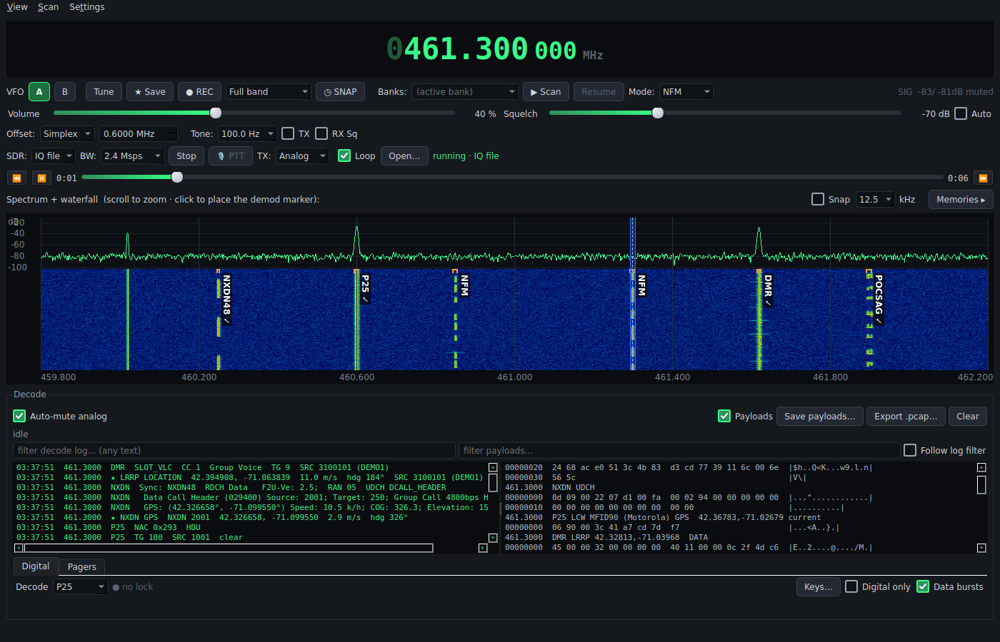
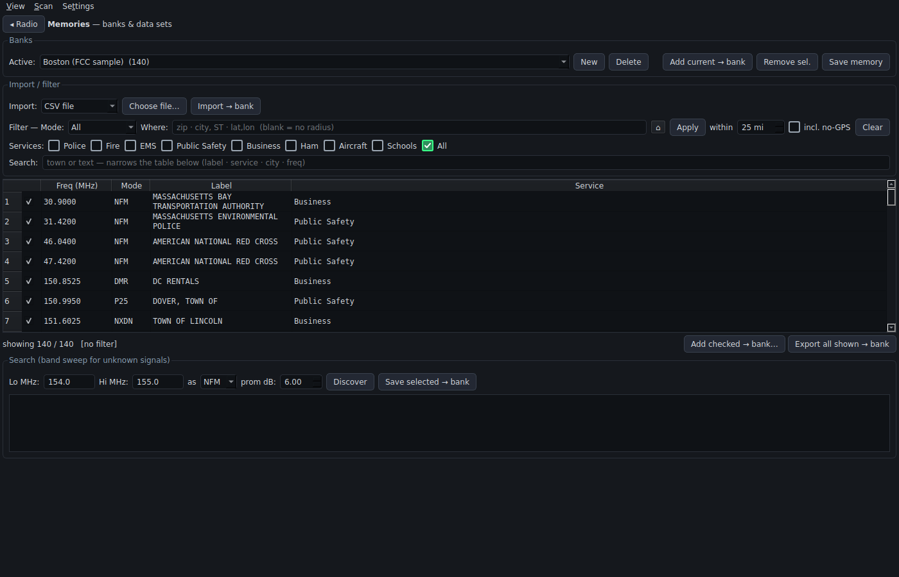
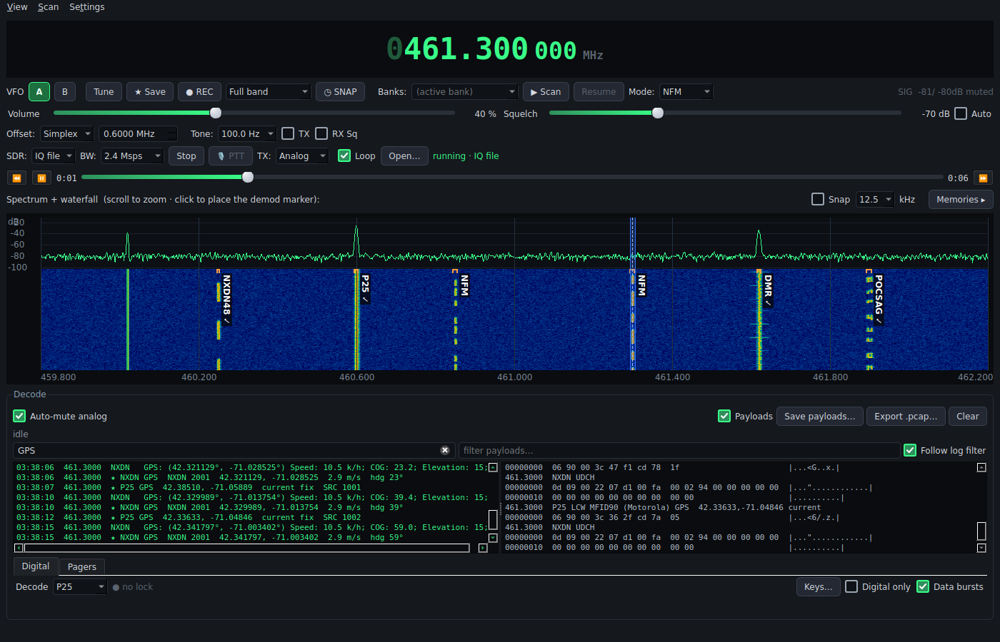
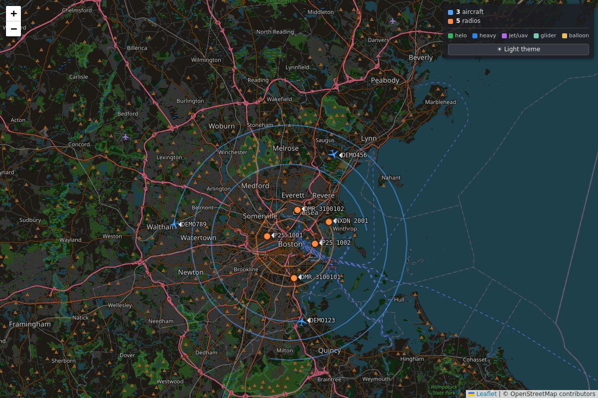
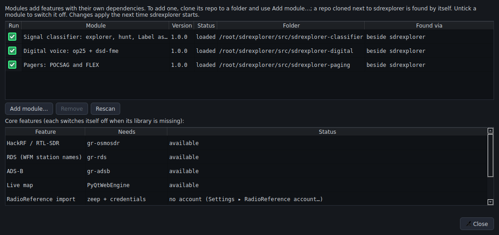

# sdrexplorer user manual

sdrexplorer is an SDR signal-analysis program. The core supports FM, AM, SSB and CW, has scanning with
memory banks, can record and replay raw I/Q, and can transmit on amateur bands. Optional **modules** add
pager decoding, digital voice and trunking, and a neural-network classifier that labels signals in real time.

This manual covers the core program and gives an overview of the modules. Each module's own README has its
details.

Contents:

1. [Before you start](#1-before-you-start)
2. [First start](#2-first-start)
3. [The main window](#3-the-main-window)
4. [Tuning](#4-tuning)
5. [Modes, audio and squelch](#5-modes-audio-and-squelch)
6. [SDR devices, capture bandwidth and gains](#6-sdr-devices-capture-bandwidth-and-gains)
7. [Memories and banks](#7-memories-and-banks)
8. [Importing channel lists](#8-importing-channel-lists)
9. [FCC license search](#9-fcc-license-search)
10. [Scanning](#10-scanning)
11. [Discover: finding signals in a range](#11-discover-finding-signals-in-a-range)
12. [Recording and replay](#12-recording-and-replay)
13. [The decode strip](#13-the-decode-strip)
14. [Transmitting](#14-transmitting)
15. [ADS-B aircraft and the live map](#15-ads-b-aircraft-and-the-live-map)
16. [Broadcast FM and RDS](#16-broadcast-fm-and-rds)
17. [Modules](#17-modules)
18. [Settings reference](#18-settings-reference)
19. [Where your data is](#19-where-your-data-is)
20. [Command line](#20-command-line)
21. [Mouse and keyboard reference](#21-mouse-and-keyboard-reference)
22. [Troubleshooting](#22-troubleshooting)
23. [Glossary](#23-glossary)

---

## 1. Before you start

**What you need:**

- a computer running Linux (best supported), macOS or Windows;
- an SDR that gr-osmosdr or SoapySDR can open: HackRF One, RTL-SDR, Airspy, bladeRF, LimeSDR, USRP,
  PlutoSDR, SDRplay, and others;
- an antenna suited to the band you want to hear;
- for transmit: a device that can transmit (HackRF, LimeSDR, PlutoSDR, …) and, in most countries, an
  amateur radio license.

**Installing** is covered in [INSTALL.md](../INSTALL.md). In short:

- **Debian / Ubuntu:** clone the repo into `~/sdrexplorer/src` and run `./sdrexplorer/install.sh`. It lists
  any system packages to install first, then sets up the core and the modules, and you start it with
  `~/sdrexplorer/bin/sdrexplorer`.
- **Other systems:** create the conda environment from `environment.yml` (it brings GNU Radio and the SDR
  drivers), then run `./run_sdrexplorer.sh` (Linux, macOS) or `run_sdrexplorer.bat` (Windows).

On Linux, add yourself to the `plugdev` group so the SDR works without root. On Windows, an RTL-SDR needs the
WinUSB driver from Zadig first.

**Without an SDR** you can still open IQ recordings (yours or someone else's) and use everything except live
reception and transmit.

## 2. First start

1. Plug in the SDR and start sdrexplorer.
2. On the **SDR:** picker (the strip above the waterfall), choose your device. Every attached device is
   listed by name and serial number.
3. Press **Start**. The waterfall begins to scroll.
4. Pick a **Mode** (for example WFM for broadcast FM).
5. Click **Tune**, type a frequency in MHz on the number keys (for example `99.5`) and press Enter. Or click
   a signal on the waterfall.
6. Raise the volume. If you hear nothing, lower the squelch (see [§5](#5-modes-audio-and-squelch)).

sdrexplorer remembers the device, frequency, mode, gains, volume, squelch and window size, and restores them
at the next start. Your settings are saved every 15 seconds and when you quit.

If the SDR status line says **not connected**, see [Troubleshooting](#22-troubleshooting).

## 3. The main window

The window has two pages: **Radio** (the default) and **Memories**. Switch with View ▸ Radio / Memories,
the **Memories ▸** and **◂ Radio** buttons, or **Ctrl+M**.

### The Radio page



*The Radio page in demo mode: the band's waterfall with the classifier's labels, the decode strip below.*

```
┌───────────────────────────────────────────────────────────────────────────────┐
│ View  Scan  Settings                                                          │  menu bar
├───────────────────────────────────────────────────────────────────────────────┤
│  0146.520 000 MHz   VFO [A][B]  Tune  ★ Save  ● REC [scope]  ◷ SNAP           │  readout and
│  Banks:[…] ▶ Scan  Resume   Mode:[NFM]   SIG -62 / -98 dB  OPEN              │  main controls
│  Volume ──────●────   Squelch ───●──── [Auto]                                 │  audio
│  Offset:[Simplex] [0.600]  Tone:[100.0 Hz] [TX] [RX Sq]                       │  repeater
│  SDR:[HackRF …]  BW:[2.4 Msps]  [Start]  🎙 PTT  TX:[Analog]  status          │  SDR strip
│  ◀◀ ❚❚ ▶▶  0:12 ━━━━━●━━━━━━ 1:30  [Loop] [Open…]   (only while replaying)    │  playback bar
│  Spectrum + waterfall …                          [Snap] [12.5] kHz Memories ▸ │
│ ┌───────────────────────────────────────────────────────────────────────────┐ │
│ │ spectrum trace                                                            │ │
│ ├───────────────────────────────────────────────────────────────────────────┤ │
│ │ waterfall (newest row at the top)        ▏tuned-channel marker▕           │ │
│ │                                                                           │ │
│ └───────────────────────────────────────────────────────────────────────────┘ │
│ ┌ Decode ─────────────────────────────────────────────────────────────────┐   │
│ │ log │ payloads │ module tabs …     [Auto-mute analog] [Payloads] [Clear] │   │  decode strip
│ └─────────────────────────────────────────────────────────────────────────┘   │
│ status bar                                                                    │
└───────────────────────────────────────────────────────────────────────────────┘
```

| Area | What it does |
|---|---|
| **Frequency readout** | Shows the tuned frequency to 1 Hz. Click digits to tune ([§4](#4-tuning)). |
| **VFO A / B** | Two independent frequency + mode memories. Click the other one to switch. |
| **Tune** | Type a frequency in MHz on the keyboard, Enter to tune, Esc to cancel. |
| **★ Save** | Save the tuned frequency to a memory bank ([§7](#7-memories-and-banks)). |
| **● REC**, scope, **◷ SNAP** | Record I/Q; save the last few seconds ([§12](#12-recording-and-replay)). |
| **Banks**, **▶ Scan**, **Resume** | Scan memory banks ([§10](#10-scanning)). |
| **Mode** | The demodulator: NFM, AM, WFM, USB, LSB, CW, ADS-B, plus modules' modes. |
| **SIG** | Signal and noise-floor level at the tuned channel, squelch state, and any CTCSS tone heard. |
| **Volume**, **Squelch** | Audio level; the level a signal must exceed to be heard. |
| **Offset**, **Tone** | Repeater split and CTCSS tone for transmit and tone squelch ([§14](#14-transmitting)). |
| **SDR strip** | Device, capture bandwidth (BW), Start / Stop, push-to-talk, transmit mode, status. |
| **Playback bar** | Appears while an IQ file plays: skip, pause, position, loop, open another file. |
| **Spectrum + waterfall** | The captured band. Click to tune, scroll to zoom, right-click for more. |
| **Snap** | Snap clicks to a channel grid (spacing in kHz). |
| **Decode strip** | The decode log, raw payloads, and tabs that modules add ([§13](#13-the-decode-strip)). |

### The Memories page



*The Memories page with the Boston FCC sample bank.*

Bank management: choose and create banks, import channel lists, filter and search, edit the channel table,
and the Discover sweep. The waterfall pauses while this page is shown. See [§7](#7-memories-and-banks) to
[§11](#11-discover-finding-signals-in-a-range).

### Menus

| Menu | Items |
|---|---|
| **View** | Radio / Memories · Waterfall labels · Waterfall during scan · Label source (Memories, Annotations, Both) · FCC license search… · Aircraft (ADS-B)… · Live map… · (modules' entries) |
| **Scan** | Start / stop scan · Resume (skip held) · Scan settings… · (modules' entries) |
| **Settings** | SDR device · RF gains… · Find SDR devices · Transmit… · Label style… · IQ snapshot… · Recording trigger… · Show recorded frequencies · Station location… · RadioReference account… · Modules… · Reset all settings… · (modules' entries) |

## 4. Tuning

The radio separates two things:

- the **band**: the stretch of spectrum the SDR captures, shown across the waterfall (2.4 MHz wide by
  default);
- the **tuned channel**: what you listen to, shown as a marker on the waterfall, anywhere inside the band.

Clicking inside the band moves only the tuned channel; the waterfall stays where it is. Typing a frequency
or recalling a memory **recenters** the band on it.

| To | Do |
|---|---|
| tune to a frequency | **Tune**, type MHz (e.g. `462.5625`), Enter. Or click the readout and type. |
| tune to a signal you see | Click it on the waterfall. With **Snap** ticked, the click lands on the nearest channel of the chosen spacing (0.1, 1, 5, 6.25, 7.5, 12.5 or 25 kHz). |
| step up or down | Left-click a digit of the readout to raise it, right-click to lower it, or turn the mouse wheel over it. |
| fine-tune | The last three digits are 100 Hz, 10 Hz and 1 Hz. These steps move only the channel, so the waterfall and any decoder lock stay put. Steps of 1 kHz and up recenter the band, as typing does. |
| change the filter width | Drag either edge of the tuned-channel marker. |
| zoom the waterfall | Scroll the mouse wheel over it; the frequency under the pointer stays put. Scroll out fully to see the whole band. |
| use two frequencies | **VFO A / B**: each keeps its own frequency and mode. |

Most SDRs have a spike at the center of the band (the "DC spike"). sdrexplorer tunes the hardware 300 kHz
below your frequency so the spike never sits on what you are listening to, and blanks it from the display.

## 5. Modes, audio and squelch

### Modes

| Mode | For | Default width |
|---|---|---|
| **NFM** | narrowband FM voice: public safety, business, amateur repeaters, FRS/GMRS, marine, weather radio | 12.5 kHz |
| **AM** | airband, AM broadcast, some HF | |
| **WFM** | broadcast FM (with RDS station names if gr-rds is installed, [§16](#16-broadcast-fm-and-rds)) | 200 kHz |
| **USB / LSB** | single-sideband voice and data on HF and VHF/UHF weak-signal | |
| **CW** | Morse code | 500 Hz |
| **ADS-B** | aircraft transponders at 1090 MHz ([§15](#15-ads-b-aircraft-and-the-live-map)) | |
| *module modes* | POCSAG, FLEX, and others, when modules are installed | |

A grayed-out mode is unavailable; its tooltip says why (usually a missing module dependency).

**CW** is tuned on the carrier: the readout shows the carrier frequency and you hear it as a 700 Hz tone. A
signal above the tuned frequency sounds higher, as on a transceiver's CW-U. Drag the marker edges to change
the 500 Hz filter in 50 Hz steps; Snap uses a 100 Hz grid.

### Squelch

The squelch mutes the audio until the signal in the tuned channel is strong enough.

- **Manual:** drag the Squelch slider. The SIG readout shows the current signal and noise floor in the
  same units, so set the squelch a little above the floor.
- **Auto:** tick **Auto**. The squelch then opens when the signal is a set margin above the measured noise
  floor, and follows the floor as it changes.

The SIG readout also shows **Tone**: the CTCSS tone actually present on an NFM signal, whatever tone you
have selected.

### Tone squelch (CTCSS)

On NFM, choose a tone in **Tone:** and tick **RX Sq** to hear only transmissions carrying that tone. (The
power squelch still applies.)

## 6. SDR devices, capture bandwidth and gains

### Choosing a device

The **SDR:** picker (also Settings ▸ SDR device) lists every device the installed drivers see, by name and
serial number, plus **IQ file** for replay. Plug in a device after starting and use **Settings ▸ Find SDR
devices**.

sdrexplorer reads what each device can do (its frequency range, capture rates, gain stages, whether it can
transmit) and builds its controls from that. Settings are kept **per device**: two SDRs keep their own
rate, gains and frequency correction.

A device that needs a SoapySDR module (for example LimeSDR: `soapysdr-module-lms7`) needs only that module
installed; nothing in sdrexplorer.

### Capture bandwidth

**BW:** sets how wide the band is: 2.4, 4.8, 9.6, 14.4 or 19.2 Msps, limited to the rates your device
accepts (an RTL-SDR offers 2.4 Msps). Wider shows more spectrum but uses more CPU. Changing it restarts the
radio.

### RF gains and frequency correction

**Settings ▸ RF gains…** shows one slider per gain stage your device reports (for a HackRF: RF amp, IF/LNA,
baseband/VGA; for an RTL-SDR: tuner gain). Raise gain until weak signals show, but not so far that the noise
floor rises across the band or strong signals create copies of themselves.

**Frequency correction** (ppm) compensates for the device's crystal error. Tune to a signal whose frequency
you know exactly, then adjust until it sits on the readout. It is saved per device.

**Reset all settings to defaults…** (in the dialog or the Settings menu) clears saved settings and restarts.
Your banks are kept unless you tick the box to delete them too.

### GPU acceleration

With an NVIDIA GPU and the optional `gr-sdrexplorer_gpu` module built ([INSTALL.md](../INSTALL.md)), the
channel filter and the waterfall FFT run on the GPU. This helps at wide capture bandwidths. The SDR status
shows "· GPU" when it is active. `--no-gpu` turns it off.

## 7. Memories and banks

A **memory** (channel) is a saved frequency with its mode, filter width, name, service, tone, notes and
location. A **bank** is a named list of memories ("County fire", "Ham repeaters"). Banks are saved
automatically and survive restarts.

### Saving a frequency

**★ Save** on the Radio page saves the tuned frequency. Choose an existing bank or type a new name, and fill
in the name, service (Police, Fire, EMS, …), tone and notes. Installed modules may store extra fields with
the memory (a digital module, for example, a talkgroup).

### The Memories page

| Control | |
|---|---|
| **Active:** bank, **New**, **Delete** | choose, create and delete banks |
| **Add current → bank** | save the tuned frequency and mode into the active bank |
| **Remove sel.** (or Delete key) | remove the selected rows |
| **Save memory** | save changes |
| the table | every memory in the active bank. **Double-click** a row to tune it. The **checkbox** includes it in scans. **Right-click ▸ Edit…** opens Edit memory. |
| **Filter**: Mode, Where + radius, Services, Search | narrow the table ([§8](#8-importing-channel-lists)) |
| **Add checked → bank…**, **Export all shown → bank** | copy channels into another bank |

**Edit memory** shows every field, and, read-only, any fields modules stored on the memory.

### The ★ Priority bank

Copy channels into **★ Priority** with *Add selected → ★ Priority* (Scan settings). While scanning with
Priority on, they are checked every few seconds, even while the scan is holding on another channel.

## 8. Importing channel lists

The **Import:** row on the Memories page loads a whole channel list into a new bank, which you can then
filter.

| Source | |
|---|---|
| **CSV file** | Your own list, or an export from RadioReference, CHIRP or SDRTrunk. Columns are matched by name: frequency, mode, name/label, service/tag, tone, latitude/longitude, city. Rows with a city but no coordinates are geocoded (and cached). |
| **FCC ULS** | The FCC's public license database (US). Click **Download FCC data** and choose a dataset: LMcomm (~80 MB), LMpriv (~420 MB) or LMbcast (~8 MB). The download resumes if the FCC server stalls. |
| **RadioReference** | Needs a paid RadioReference Premium subscription; uses their official API only. Enter the account in Settings ▸ RadioReference account…. Needs the `zeep` package. |
| *module importers* | Modules can add more sources here. |

To try it, import `sdrexplorer/samples/boston_fcc_sample.csv`: 140 licensed channels around Boston
(FM voice, P25, DMR and NXDN) taken from the FCC's public license data.

For FCC and RadioReference, type a place in **Where** (a ZIP code, "City, ST", or "lat,lon") to choose the
region, then **Import → bank**.

### Filtering

Once a bank is loaded, filter it live:

- **Mode**: only one mode.
- **Where** + **within** (miles): only channels within a radius of a place. **Apply** geocodes the place.
  The button next to it uses your station location. **incl. no-GPS** keeps channels that have no
  coordinates.
- **Services**: Police, Fire, EMS, … The match is by keyword, so "Police" also finds "Law Dispatch".
- **Search**: free text over names, cities and notes.

**Export all shown → bank** saves the filtered view as a new bank, so you can make banks per area or service
from one large import. A scan runs whatever the table currently shows.

## 9. FCC license search

**View ▸ FCC license search…** (or **Search FCC data…** on the Memories page) searches the downloaded FCC
data without importing it.

1. Download a dataset first ([§8](#8-importing-channel-lists)). The first search builds an index
   (`uls_index.sqlite`, about 35 seconds for LMpriv); later searches take under a second.
2. Filter by place and radius, frequency (one value means ±1 kHz, or give a range), licensee, call sign or
   city, service, and emission type (P25 Phase 1 / 2, DMR, NXDN, NFM voice, …).
3. Emission designators are shown by name ("11K2F3E" → "NFM voice (12.5 kHz)"); the raw codes are in their
   own column.
4. **Double-click** a row to tune it. **Add selected → bank…** copies rows into a bank.

A license lists what is **allowed** at a location, not what is actually on the air.

## 10. Scanning

A scan steps through memories and **stops on an active one**: a channel whose signal breaks the squelch
level. It resumes by itself once the signal has been gone for the hang time.

1. On the Radio page, pick the bank(s) to scan in **Banks:** (tick one or more; none means the active bank).
   Only memories with their checkbox ticked, and passing the Memories page filter, are scanned.
2. Set the squelch so the noise floor stays below it.
3. Press **▶ Scan** (or Scan ▸ Start / stop scan).
4. On an active channel the scan holds and plays it. **Resume** skips it at once.

**Scan ▸ Scan settings…**:

| Setting | |
|---|---|
| **Dwell ms** | settle time on each channel before measuring (120–1000 ms). Too short, and a read can still reflect the previous channel. |
| **Hang s** | how long to keep holding after the signal drops (0 = resume immediately) |
| **Priority scan** every *n* s | check the ★ Priority bank periodically and jump to an active priority channel |
| **Add selected → ★ Priority** | copy the selected memories into the Priority bank |

**View ▸ Waterfall during scan** chooses whether the waterfall keeps updating while the scan sweeps.

## 11. Discover: finding signals in a range

**Discover** (Memories page) sweeps a frequency range and lists the signals it finds.

1. Enter **Lo MHz** and **Hi MHz**, the mode to save them as, and the **prom dB** threshold (how far a peak
   must stand above its surroundings).
2. Press **Discover**. The SDR steps through the range.
3. Select the results you want and **Save selected → bank**.

## 12. Recording and replay

sdrexplorer records raw I/Q, so a recording can be replayed later through every demodulator and decoder,
exactly as if it were live.

### Ways to record

| Control | Records | File name |
|---|---|---|
| **● REC**, scope *Full band* | the whole captured band (large: a 2.4 Msps band is about 9.6 MB/s) | `iq_band_<MHz>_<time>.cs16` |
| **● REC**, scope *Demod window* | only the tuned channel, 240 kHz wide (small) | `iq_chan_<MHz>_<time>.cs16` |
| **◷ SNAP** | the **last few seconds** of the band, from a memory buffer, plus 2 s after the click: for a transmission that is already over | `iq_snap_<MHz>_<time>.cs16` |
| right-drag ▸ **Record this sub-band** | a window you drag across the waterfall, filtered and decimated | `iq_sub_<MHz>_<kHz>_<time>.cs16` |
| right-drag ▸ **Snapshot this sub-band** | the last few seconds of that window | `iq_snapsub_…` |
| right-drag ▸ **Record when a signal appears** | each transmission in that window, as its own file, until stopped | `iq_trig_…`, plus `iq_pretrig_…` |

Click **● REC** again to stop. Esc stops a sub-band recording.

**Snapshot length**: Settings ▸ IQ snapshot… (default 10 s; 0 turns the buffer off and saves its memory).

**Recording trigger** (Settings ▸ Recording trigger…): the threshold above the noise floor that starts a
recording, the hang time (keep recording through speech pauses and TDMA gaps), the longest single file, and
whether to save the seconds before the trigger as a separate `iq_pretrig_*` file. While armed, **■ DISARM**
(or Esc) stops watching.

Recordings go to the recordings folder ([§19](#19-where-your-data-is)). You can sort them into subfolders;
the replay dialog browses into them.

**Settings ▸ Show recorded frequencies** marks channels that already have recordings with a ▼ on the
waterfall. Hover a mark to see what was recorded there.

### Labels from decoders

While you record, every decode a module makes is counted. When the recording ends, the most frequent
protocol is written into its sidecar as its label (for example "this recording is DMR, color code 1").
Recordings of decodable signals become labeled examples without any manual tagging.

### Replay

Choose **IQ file** on the SDR picker, or **Open…** on the playback bar, and pick a `.cs16` file. The
playback bar shows the position:

| Control | |
|---|---|
| ◀◀ / ▶▶ | skip back / forward |
| ❚❚ | pause / resume (Space while the bar has focus) |
| slider | drag or click to jump |
| **Loop** | start over at the end |
| **Open…** | another file |

During replay the band is fixed by the file. Clicking the waterfall tunes within it; typing a frequency
outside it isn't possible. Decoders see the file's original time, so decode logs show when the signal was
actually received.

### Recording file format

A recording is two files:

- `<name>.cs16`: interleaved signed 16-bit I and Q samples (full scale 32767), the format most SDR programs
  open as "complex int16".
- `<name>.cs16.json`: the sidecar, describing the recording.

| Sidecar key | |
|---|---|
| `center_hz` | center frequency of the file |
| `chan_hz` | the frequency that was tuned |
| `samp_rate` | sample rate of the file |
| `rf_bw_hz` | (sub-band) the width that was selected |
| `format`, `iq_size`, `iq_signed` | `"cs16"`, 2, true |
| `mode` | the mode that was picked |
| `scope` | `"band"`, `"demod"`, `"subband"` (snapshots: `"band"` or `"subband"`) |
| `start_time` | Unix time of the first sample |
| `decoded` | (if a decoder ran) `label`, `label_frac`, and per protocol: frames, first and last time, ids |

### Sharing recordings

Recordings of real signals are what make the signal classifier better. To share one without giving away
where or when it was recorded, cut it down first:

```
python -m sdrexplorer.contribute crop recordings/iq_sub_….cs16 --label NBFM --bw 12.5
```

It finds the signal near the recording's tuned frequency (or the one you give with `--freq`), moves it to
0 Hz, keeps up to five 2-second stretches where it is on, and writes `contribution-<random>.zip`. The zip
holds the label, the sample rate and bandwidth, and, if a decoder module can check the label, whether each
crop decodes. It does **not** hold the frequency (`--band` adds a coarse name like "UHF" instead), the file
name, the date or time, your position, or any decoded ids.

What the signal itself carries is still in it: a crop of voice is voice, and a data burst may contain unit
ids or a position. Share only signals you may share. `python -m sdrexplorer.contribute crop --help` lists
the options (`--seconds`, `--crops`, `--start` / `--length` for part of a long recording).

Whoever receives it adds it to their real-data store with
`python -m sdrexplorer.contribute ingest contribution-….zip --profile <name>`.

## 13. The decode strip



*The log filtered on "GPS" with Follow log filter on: the payload pane shows the raw bursts behind those lines.*

The strip under the waterfall collects what decoders produce.

| Part | |
|---|---|
| **Log** | One timestamped line per decode, with the station name from your memories where it matches (a P25 NAC, DMR color code or NXDN RAN that matches a memory's tone code). Repeated messages are shown once. |
| **Payloads** | Tick to show decoders' raw data as a hex dump beside the log. **Save payloads…** writes them as text; **Export .pcap…** writes those with a network link type for Wireshark (one file per link type). |
| **Filters** | The box over the log shows only lines containing its text; the box over the payloads does the same for the hex dumps. Tick **Follow log filter** to filter the payloads with the log's text instead: you then see the raw payloads of the log lines that match (the same decoded burst, e.g. a unit id or "LRRP" in the log shows that burst's bytes), plus any payload that contains the text itself. |
| **Auto-mute analog** | Let decoder modes mute the analog audio (a data mode's warble). |
| **Clear** | Empty the log. |
| *module tabs* | Each module adds its own tab (Pagers, Digital, Activity, …). |

## 14. Transmitting

> **Transmitting is regulated.** You need a license for the frequency and mode you use. By default,
> sdrexplorer transmits only inside the US amateur bands. You are responsible for every transmission.

Transmit needs a device that can transmit (HackRF, LimeSDR, PlutoSDR, …). PTT is not offered on a
receive-only device such as an RTL-SDR; its tooltip says why.

1. Tune to the frequency. For a repeater, tune to its **output** and set **Offset:** to − or + and the
   split. sdrexplorer fills these in from the US band plan when you tune (−5 MHz on 70 cm, ±600 kHz on 2 m,
   …).
2. If the repeater needs a tone, choose it in **Tone:** and tick **TX**.
3. Choose the audio source in **Settings ▸ Transmit…**: **Microphone**, or an **Audio file** (WAV, with
   **Loop** if wanted; otherwise PTT releases at the end of the file).
4. Click **🎙 PTT** to transmit; click again to stop. The receiver stops while you transmit (most SDRs can't
   do both) and comes back afterwards. The waterfall shows your transmitted signal meanwhile.

**TX:** chooses what is transmitted. **Analog** follows the receive mode (NFM, AM, WFM, USB, LSB). Modules
can add digital transmit modes here (the digital module adds P25 and DMR); the settings that change from
channel to channel appear beside the picker (P25: TG and NAC; DMR: TG and CC), and the ones that stay the
same, like your radio id, are in Settings ▸ Transmit.

To transmit outside the amateur bands (only where you are licensed to), tick *Allow transmit outside the US
amateur bands* in Settings ▸ Transmit.

## 15. ADS-B aircraft and the live map



*The live map in demo mode: aircraft with their trails and decoded radio positions (all made up).*

Needs the optional **gr-adsb** ([README](../README.md#ads-b-1090-mhz--live-map--optional)).

Pick **ADS-B** in the Mode picker. The SDR moves to 1090 MHz and decodes aircraft transponders.
**View ▸ Aircraft (ADS-B)…** shows a table of aircraft: ICAO address, call sign, class (helicopter,
heavy, jet, light, glider, UAV, balloon, as the aircraft reports it), altitude, speed, track, position,
message count and the age of the last message. The
detect threshold in that window sets the sensitivity.

**View ▸ Live map…** plots aircraft with their heading and trails, and any radio positions modules decode
(for example GPS reports in digital radio data), on an OpenStreetMap map with dark and light themes. It
needs **PyQtWebEngine**; the map tiles need an internet connection. Settings ▸ Label style… sets the map's
label size and color.

## 16. Broadcast FM and RDS

In **WFM**, sdrexplorer decodes RDS when the optional **gr-rds** is installed: the station name, RadioText
and program type appear in the tuning display a few seconds after a strong station locks. Without gr-rds,
WFM plays normally and the decode status notes that RDS isn't available.

## 17. Modules

Modules add features that need extra software. Each is a separate download.

### Managing modules



*Settings ▸ Modules: the modules found, and the core's optional features.*

**Settings ▸ Modules…** lists every module found, with its version, status, folder and how it was found.

| Status | Meaning |
|---|---|
| loaded | running |
| off | you switched it off |
| unavailable: *reason* | something it needs is missing; the reason says what |
| error: *reason* | it can't load at all (an import error, or written for another sdrexplorer version) |

- **Adding a module**: download (clone) its repository to any folder, then **Add module…** and pick that
  folder. It is checked first, then remembered. A module downloaded into the folder next to sdrexplorer
  (named `sdrexplorer-…`) is found by itself.
- **Switching off**: untick it. **Remove** forgets a folder you added (nothing is deleted). **Rescan** looks
  again.
- Changes take effect the next time sdrexplorer starts.
- The lower table shows the core's own optional features (ADS-B, RDS, the map, GPU, RadioReference) and
  whether each is available.

`--modules a,b` runs only those modules for one run; `--no-modules` runs none ([§20](#20-command-line)).

### The modules

| Module | Adds | Needs |
|---|---|---|
| **sdrexplorer-paging** | **POCSAG** (512 / 1200 / 2400 bps) and **FLEX** (1600 / 3200 / 6400 bps) in the Mode picker. Follows the transmitter's deviation up to ±16 kHz and either FSK polarity. A Pagers tab with the measured deviation and *Mute the FSK warble*. | gr-pager for FLEX |
| **sdrexplorer-digital** | A Digital tab: **P25** Phase 1, **DMR** (repeater outputs with op25; radios' own transmissions, such as simplex and repeater inputs, switch to dsd-fme by themselves, or pick **DMR-MS**), **NXDN48 / NXDN96**, **EDACS** decode; **SmartNet / SmartZone** control channels; decoded voice through the speaker; P25 decryption keys; data bursts to the payload pane; positions on the map (DMR LRRP, NXDN and P25 GPS reports, in the decode log too); **P25 and DMR transmit**. | op25 and / or dsd-fme |
| **sdrexplorer-classifier** | The **signal explorer** (labels every signal in the band on the waterfall); **auto mode** (tuning onto a labeled signal picks its mode or decoder); **Label as…** (save training examples); the **signal hunt** (search for new signals of one mode and record them); a **phone remote**. | ONNX Runtime (set up from its settings); its trained models, installed by `install.sh` from the sdrexplorer-models release (CC BY 4.0) |
| **sdrexplorer-train** | Builds and deploys classifier models from synthetic data and your labeled recordings. | PyTorch |

When a module labels a signal on the waterfall (View ▸ Label source ▸ Annotations or Both), right-click it
for the module's actions, and a tag stays on the row where the signal was last seen after it stops.

## 18. Settings reference

| Setting | Where | |
|---|---|---|
| SDR device | SDR picker, Settings ▸ SDR device | which device; per-device settings follow it |
| Capture bandwidth | BW: picker | band width; restarts the radio |
| RF gains, frequency correction | Settings ▸ RF gains… | per device |
| Find SDR devices | Settings | look again for devices plugged in after start |
| Transmit | Settings ▸ Transmit… | audio source, file and loop, transmit-mode settings, the out-of-band override |
| Label style | Settings ▸ Label style… | waterfall and map label size and colors |
| IQ snapshot | Settings ▸ IQ snapshot… | length of the ◷ SNAP buffer |
| Recording trigger | Settings ▸ Recording trigger… | threshold, hang, maximum length, pre-trigger seconds |
| Show recorded frequencies | Settings | ▼ marks on channels that have recordings |
| Station location | Settings ▸ Station location… | your position (place name or lat,lon, **Look up**). Used by the import filter and by modules. |
| RadioReference account | Settings ▸ RadioReference account… | for the RadioReference import; stored in the local keystore |
| Modules | Settings ▸ Modules… | [§17](#17-modules) |
| Scan | Scan ▸ Scan settings… | [§10](#10-scanning) |
| Waterfall labels | View | memory names on the waterfall |
| Label source | View ▸ Label source | label the waterfall with memories, modules' annotations, or both |
| Reset all settings | Settings | back to defaults, optionally deleting banks; restarts |

## 19. Where your data is

Your data lives outside the program folder.

| What | Linux | macOS | Windows |
|---|---|---|---|
| banks, session state, device settings, caches | `~/.local/share/sdrexplorer/memory/` | `~/Library/Application Support/sdrexplorer/memory/` | `%LOCALAPPDATA%\sdrexplorer\memory\` |
| IQ recordings | `~/.local/share/sdrexplorer/recordings/` | `…/sdrexplorer/recordings/` | `…\sdrexplorer\recordings\` |
| FCC downloads and index | `~/.local/share/sdrexplorer/uls/` | `…/uls/` | `…\uls\` |
| labeled examples (classifier) | `~/.local/share/sdrexplorer/realdata/` | `…/realdata/` | `…\realdata\` |
| classifier models | `~/.local/share/sdrexplorer/models/` | `…/models/` | `…\models\` |
| paths, keystore, station location | `~/.config/sdrexplorer/` | `~/Library/Application Support/sdrexplorer/` | `%APPDATA%\sdrexplorer\` |

The important files:

| File | Contents |
|---|---|
| `memory/banks.json` | all your banks and memories |
| `memory/state.json` | the session: frequency, mode, gains, window, modules' settings |
| `memory/sources.json` | per-device settings |
| `config/paths.json` | where external builds and data folders are, added module folders, modules you switched off |
| `config/secrets.json` | keys and account details (readable only by you) |
| `config/station.json` | your station location |

**Back up** `banks.json` and your recordings. **Portable mode** (`--portable`) keeps everything under the
program's own `data/` folder, for a USB stick or a self-contained install.

To move a folder (for example recordings to a large disk), set it in `paths.json`:

```json
{ "recordings_dir": "/mnt/big/sdr-recordings" }
```

`./run_sdrexplorer.sh --paths` prints where everything is and how it was found.

## 20. Command line

```
./run_sdrexplorer.sh [options]          (or: python -m sdrexplorer.app [options])
```

| Option | |
|---|---|
| `--portable` | keep settings, banks and recordings under `<install>/data` (also `SDREXPLORER_PORTABLE=1`) |
| `--modules A,B` | run only these modules, this time |
| `--no-modules` | run no modules, this time |
| `--module-option NAME.KEY=VALUE` | an option for one module, this run (repeatable); each module's README lists its own |
| `--paths` | print where data and external builds are found, which optional features are available, and exit |
| `--gpu` / `--no-gpu` | require / disable the CUDA acceleration |

Environment variables: `SDREXPLORER_<KEY>` sets any path key (for example `SDREXPLORER_RECORDINGS_DIR`,
`SDREXPLORER_GR_ADSB`); `SDREXPLORER_MODULE_DIRS` adds module folders for one run.

### Demo mode

```
python3 tools/demo.py              (from the sdrexplorer folder)
```

Runs sdrexplorer without an SDR, to see what it looks like: a generated band replays in a loop, with
made-up decodes in the decode strip, made-up positions (units driving around Boston) on the live map, and
the classifier's labels on the waterfall. Everything shown is synthetic, and nothing is received or
transmitted. Your settings, memories and recordings aren't read or changed: the demo keeps everything in a
temporary folder. The decodes need the digital and paging modules installed beside the core.
`--shots DIR` saves the screenshots used in this manual to DIR and quits.

## 21. Mouse and keyboard reference

| Where | Action | Effect |
|---|---|---|
| waterfall | left-click | tune there (within the band) |
| waterfall | drag a marker edge | change the filter width |
| waterfall | mouse wheel | zoom in / out around the pointer |
| waterfall | right-click | menu: Tune here, and modules' actions for the signal there |
| waterfall | right-drag across | select a sub-band: record, snapshot, or record when a signal appears |
| readout | left / right click a digit | raise / lower that digit |
| readout | mouse wheel over a digit | step that digit |
| readout | type digits | start frequency entry; Enter tunes, Esc cancels |
| memory table | double-click | tune that memory |
| memory table | Delete | remove the selected rows |
| playback bar | Space | pause / resume |
| anywhere | **Ctrl+M** | switch between the Radio and Memories pages |
| anywhere | **Esc** | stop a sub-band recording; disarm the recording trigger |

## 22. Troubleshooting

**"not connected" / the waterfall doesn't move**

- Check the cable and that the device is chosen on the SDR picker, then press Start.
- Linux: are you in the `plugdev` group (log out and in after adding)? Are the udev rules installed? Test
  with `hackrf_info` or `rtl_test`.
- Windows, RTL-SDR: install the WinUSB driver with Zadig.
- Another program may have the device open. Close it.
- Settings ▸ Find SDR devices after plugging in.
- The status tooltip shows the full error.

**The window stops responding**

Find its process id with `pgrep -af sdrexplorer.app` (with several running, pick the one that hangs) and run
`kill -USR1 <pid>` in another terminal. sdrexplorer keeps running and prints what every thread is doing to
the terminal it was started from; include that in a bug report ([CONTRIBUTING](../CONTRIBUTING.md)), with
the native stacks from `sudo gdb -p <pid> -batch -ex "thread apply all bt"`.

**No sound**

- Volume up? Squelch below the signal (or tick Auto)?
- Is a module muting analog? Untick **Auto-mute analog** in the decode strip to check.
- Is RX Sq ticked with a tone the signal doesn't carry?

**The waterfall is full of noise, or signals appear twice**

- Gain too high: lower the RF gains. Mirror images of strong signals mean overload.

**A mode is grayed out**

- Hover it: the tooltip says what is missing (for example "needs gr-pager"). Check the module's README.

**A module doesn't appear**

- Settings ▸ Modules: is it listed? Its status says why it isn't loaded. The terminal shows the full error.
- Was it added after start? Modules load at the next start.

**Where are my files?** `./run_sdrexplorer.sh --paths`.

**Start over**: Settings ▸ Reset all settings… (keeps your banks unless you tick the box).

When reporting a problem, include the output of `./run_sdrexplorer.sh --paths` and the terminal output.

## 23. Glossary

| Term | |
|---|---|
| **band** | the stretch of spectrum the SDR captures at once, shown across the waterfall |
| **capture bandwidth / sample rate** | how wide the band is, in samples per second (Msps) |
| **CTCSS** | a sub-audible tone sent with NFM voice; tone squelch opens only for it |
| **DC spike** | a spurious signal at the center of the band that most SDRs produce |
| **I/Q** | the raw complex samples an SDR delivers; recordings keep them, so any demodulation is possible later |
| **memory / channel** | a saved frequency with its settings |
| **bank** | a named list of memories |
| **module** | an optional add-on that brings its own features and dependencies |
| **sidecar** | the `.json` file next to a recording that describes it |
| **squelch** | the level a signal must exceed before you hear it |
| **VFO** | a tuning register: frequency and mode; sdrexplorer has two, A and B |
